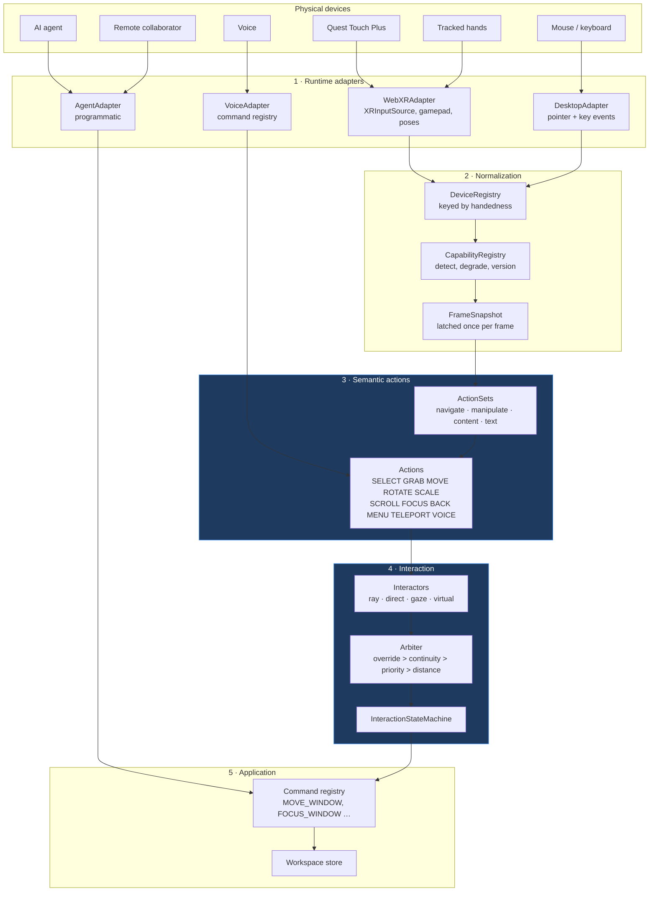
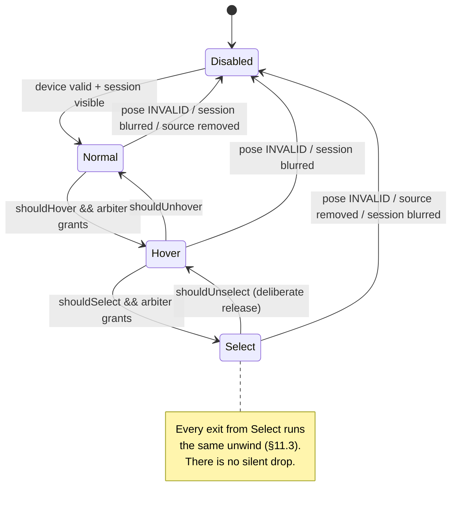
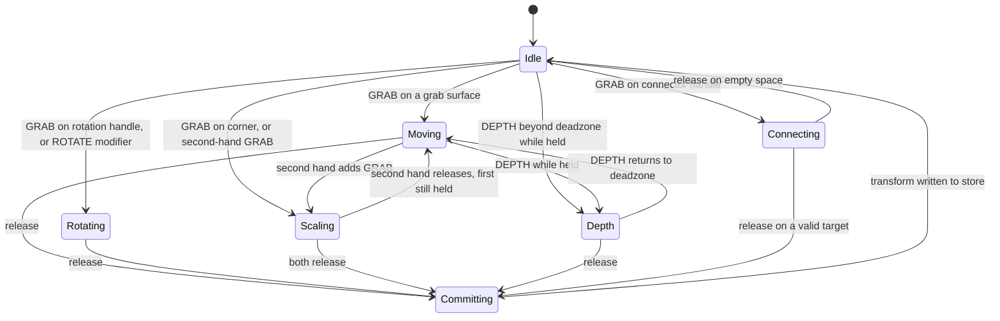
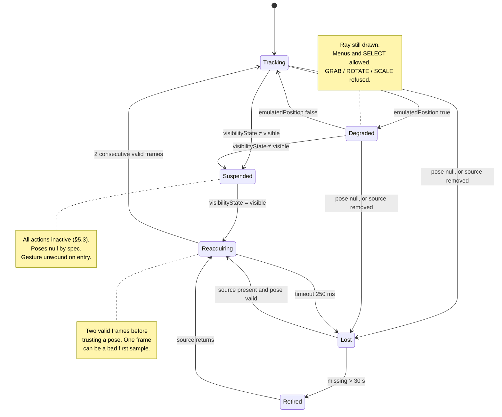
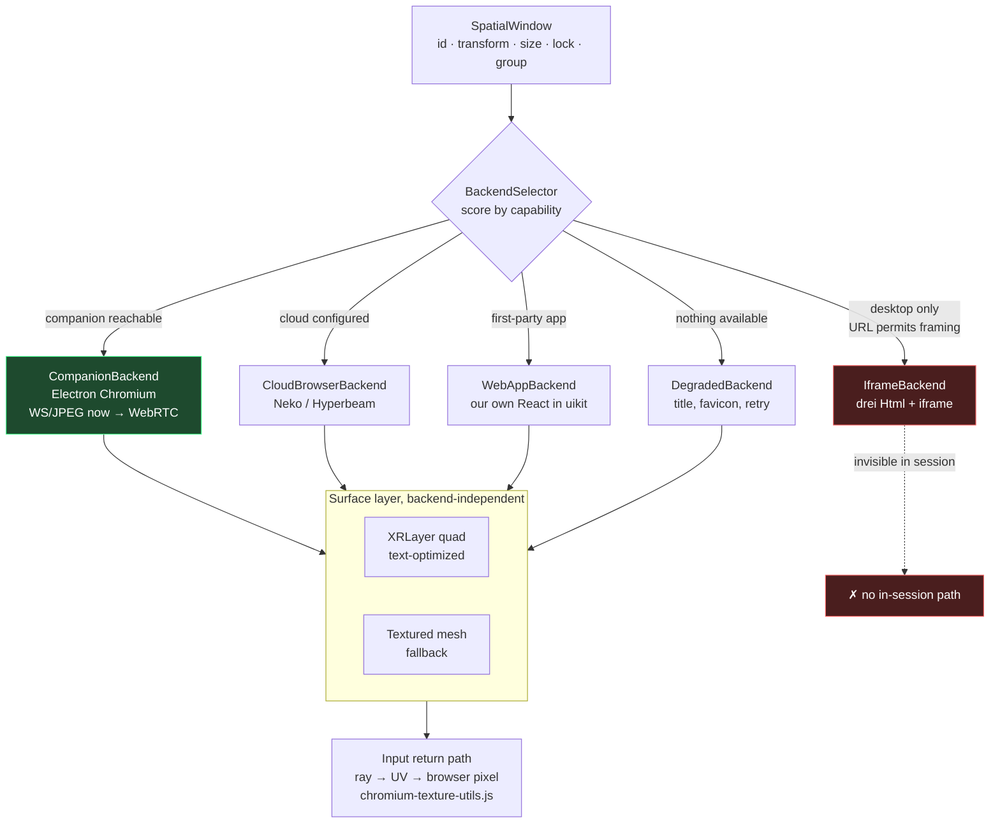
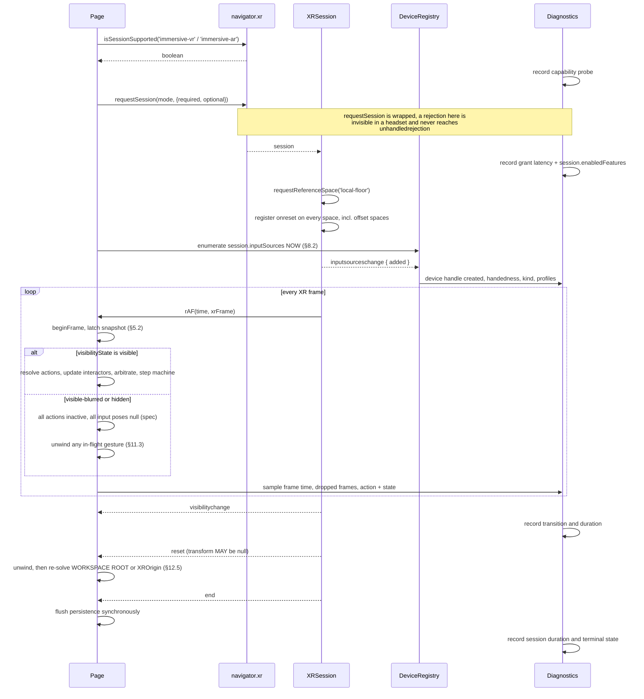
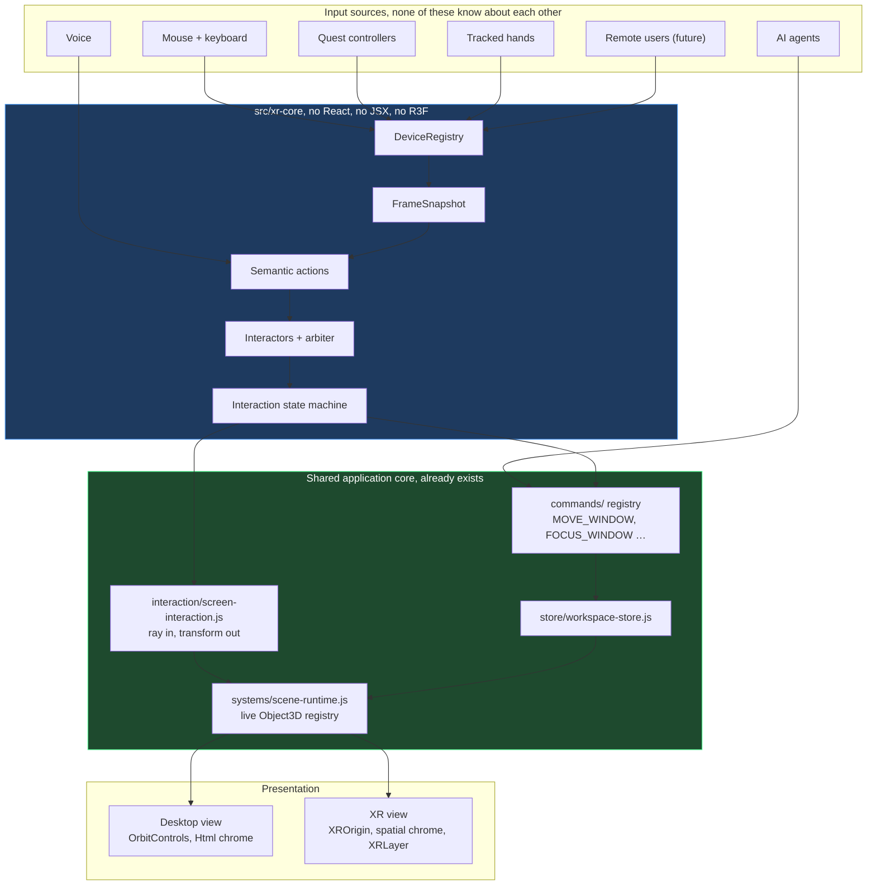

# Control Center 3D, XR Foundation Architecture

Research date: 2026-09-03. Hardware target: Meta Quest 3 / Quest 3S, Horizon OS,
Meta Quest Browser (Chromium 146 line). Existing application: `spatial-command-center`
v0.2.0, React 18.2 / three 0.163 / @react-three/fiber 8.16.2 / @react-three/xr 6.6.30.

This document is a blueprint, not a changelog. It is written to be handed to a coding
agent, so every recommendation is classified and every load-bearing claim is sourced.

**Reading conventions.**

Recommendations carry one of: `REQUIRED NOW`, `RECOMMENDED NOW`, `FUTURE`,
`EXPERIMENTAL`, `AVOID`.

Technologies carry one of: `STABLE`, `PARTIALLY SUPPORTED`, `EXPERIMENTAL`,
`META-SPECIFIC`, `BROWSER-SPECIFIC`, `NOT RECOMMENDED`.

Claims are marked **FACT** (a spec quote, official documentation, or source I read),
**COMMUNITY** (reported by developers, corroborated but not official), or
**ASSUMPTION** (my inference, flagged so you can disagree with it). Where official
documentation contradicts widespread tutorial advice, that conflict is called out
explicitly rather than silently resolved.

---

## 1. Executive summary

Control Center 3D already has more working XR than the brief assumed. It runs
`@react-three/xr` v6 with `createXRStore`, it has been inside a real Quest 3 on
OculusBrowser 150.1, and `docs/WEBXR_HEADSET_FINDINGS.md` records two solved faults
and one measured result that most WebXR projects never get to. Its interaction maths
in `src/interaction/screen-interaction.js` is already ray-based and pixel-free, which
is the hard part and the part most projects get wrong.

So this is not a foundation-laying exercise. It is a diagnosis of the four layers the
system is missing, and a design for them.

**The four missing layers, in the order they cause pain:**

1. **No semantic action layer.** `src/xr/XrControllerInput.jsx` reads
   `controller.gamepad['xr-standard-squeeze'].state` directly. Application intent is
   welded to a hardware button on one vendor's controller.
2. **No interaction state machine.** Grab state lives in a `grabRef`, a `pinchRef`,
   and two Zustand booleans that are updated independently and can disagree.
3. **No tracking-loss recovery.** This is not a theoretical gap; there is a live
   defect described in §21.1 that leaves a window permanently grabbed.
4. **No capability registry.** Features are assumed rather than detected, so a
   missing capability fails at the point of use instead of at the point of decision.

**The single most important architectural claim in this document:** the reason XR
input feels fragile is not that the XR code is bad. It is that the XR code is
*structured as a feature* rather than *as a system*. A feature reads hardware and
mutates the scene. A system latches hardware into a frame-coherent snapshot, resolves
it into semantic actions, arbitrates between competing interactors, drives a state
machine, and emits commands. Everything in §5 through §11 is an argument for the
second shape.

**The second most important claim:** you cannot render an arbitrary live website as a
texture from inside a browser. Not with an iframe, not with a canvas trick, not with
any current or proposed web API. §14 establishes this with primary sources. The
consequence is that the WebSocket/JPEG remote host in `electron/host/remote-host.cjs`
is not a workaround for CSP, it is the only architecture that exists, and it should
be treated as a first-class permanent component rather than as scaffolding.

**What the interaction model should be.** No modes. The content area of a panel is
always live; the bezel, the control bar and the corner handles are always the grab
surfaces. Geometry performs the disambiguation, so "I meant to click and it moved"
becomes structurally impossible rather than tuned against. This matches what Horizon
OS and visionOS have already taught users' hands. The existing Browse/Arrange mode
survives as an expert accelerator, not as the primary mechanism. §6 and §13 develop
this.

**What this document does not recommend.** It does not recommend a native rewrite.
§16 gives the comparison honestly and defines the specific conditions under which
leaving the browser becomes correct, but none of them are true today, and the
existing React/Three.js investment is worth more than the capabilities a native
build would add right now.

### 1.1 The ten decisions

| # | Decision | Class |
|---|---|---|
| D1 | Frame-is-the-handle interaction model; no mandatory modes | `REQUIRED NOW` |
| D2 | OpenXR-shaped semantic action layer with frame-latched sync | `REQUIRED NOW` |
| D3 | Input core built on vanilla `@pmndrs/xr`, React as view only | `REQUIRED NOW` |
| D4 | Key all input state by `handedness`, never by object identity or slot | `REQUIRED NOW` |
| D5 | Tracking loss runs the same unwind path as a deliberate release | `REQUIRED NOW` |
| D6 | Web content backends as a ranked capability registry | `RECOMMENDED NOW` |
| D7 | Controllers tuned first; hands correct but tuned second | `RECOMMENDED NOW` |
| D8 | Failures visible, calm, and local to one panel | `REQUIRED NOW` |
| D9 | Quad compositor layers for panel surfaces, after a leak spike | `RECOMMENDED NOW` |
| D10 | Persist one spatial anchor; store windows as offsets from it | `FUTURE` |

---

## 2. What WebXR can actually guarantee

Very little is guaranteed, and the guarantees that exist are narrower than they look.
This section is the honest floor.

### 2.1 Guaranteed by specification

**FACT**, The core WebXR Device API is a **W3C Candidate Recommendation Draft of
9 June 2026**. It is not a Recommendation. https://www.w3.org/TR/webxr/

These hold on any conforming implementation:

| Guarantee | Source |
|---|---|
| `viewer` reference space is always available | https://www.w3.org/TR/webxr/#feature-requirements |
| `XRInputSource.targetRaySpace` always exists | https://www.w3.org/TR/webxr/#xrinputsource-interface |
| `select`/`selectstart`/`selectend` fire for any primary input source | https://www.w3.org/TR/webxr/#input |
| Button index 0 of an `xr-standard` gamepad is the primary trigger | https://www.w3.org/TR/webxr-gamepads-module-1/ |
| A `reset` event fires on native-origin discontinuity | https://www.w3.org/TR/webxr/#xrreferencespace-interface |
| `inputsourceschange` fires when sources are added or removed | https://www.w3.org/TR/webxr/#input |

That is close to the whole list. Everything else, floor level, grip pose, hand
joints, thumbsticks, haptics, passthrough, layers, anchors, is optional, and must be
requested and then verified.

### 2.2 Guaranteed *not* to behave the way tutorials assume

These are spec-mandated behaviours that most WebXR code gets wrong. Each is quoted
because paraphrasing them loses the force.

**Input source objects are live and mutated in place.**

> "XRInputSources in an XRSession's inputSources array are 'live'. As such, values
> within them are updated in-place. **This means that it doesn't work to save a
> reference to an XRInputSource's attribute on one frame and compare it to the same
> attribute in a subsequent frame to test for state changes, because they will be the
> same object.**"
>, https://www.w3.org/TR/webxr/#xrinputsource-interface

*Conflict with common practice:* a great deal of tutorial code stashes
`inputSource.gamepad.buttons` across frames and diffs it. Per spec this can never
detect a change. You must copy the scalar `.pressed` / `.value` / `.axes` values each
frame. This is one of the reasons §5 insists on a latched snapshot.

**A new input source object is minted on any identity change.**

> "When the **handedness, targetRayMode, profiles, presence of a gripSpace or the
> status as a primary input source or tracked input source** for any XR input sources
> change ... Add oldInputSource to removed primary sources. **Let newInputSource be a
> new XRInputSource** ... Add newInputSource to added primary sources."
>, https://www.w3.org/TR/webxr/#input

Both arrive in a *single* `inputsourceschange` event, one in `removed` and one in
`added`. So object identity is not a session-stable key. §10 builds on this.

**All input-source poses return `null` when the session is blurred.**

> "If session's visibilityState is `visible-blurred` **and space or baseSpace is
> associated with an XRInputSource, set pose to null and abort these steps.**"
>, https://www.w3.org/TR/webxr/#populate-the-pose

And the state definition itself:

> `visible-blurred`: "imagery rendered by the XRSession may be seen by the user, but
> is not the primary focus. requestAnimationFrame() callbacks MAY be throttled.
> **Input is not processed by the XRSession.**"
>, https://www.w3.org/TR/webxr/#xrsession-interface

This is the single most operationally important sentence in the specification for
this project. Every system menu, every permission prompt, and the Quest system
keyboard all trigger it. `getViewerPose()` keeps working; every controller and hand
pose goes `null`. Code that does not null-check throws; code that hides on `null`
makes controllers vanish; code that skips the update leaves them frozen. All three
are observable in the wild, and none of them is a bug in the runtime.

**`selectend` without `select` means cancelled, not clicked.**

> "Sometimes platform-specific behavior can result in a primary action or primary
> squeeze action being interrupted or cancelled. For example, an XR input source may
> be removed from the XR device after the primary action ... is started but before it
> ends."
>, https://www.w3.org/TR/webxr/#input

In that case the user agent fires `selectend` with **no preceding `select`**.

*Conflict with common practice:* tutorials routinely treat `selectend` as "the user
released, therefore a click happened." That is wrong, and it is exactly the code path
that fires on Quest when the Meta button interrupts a held trigger. Handle `select`
for the click and `selectend` purely for state teardown.

**An untracked controller freezes; it does not disappear.**

> "Set transform's position to the tracking system's best estimate ... This MAY
> include a computed offset such as a neck or arm model. **If a position estimate is
> not available, the last known position MUST be used.**"
>, https://www.w3.org/TR/webxr/#populate-the-pose

And `XRPose.emulatedPosition` is:

> "false when the transform represents an actively tracked 6DoF pose based on sensor
> readings, or true if its position value includes a computed offset, such as that
> provided by a neck or arm model."
>, https://www.w3.org/TR/webxr/#xrpose-interface

So a Quest controller leaving the headset's camera volume does not null out. It
switches to dead reckoning, `emulatedPosition` becomes `true`, `linearVelocity` and
`angularVelocity` become `null`, and eventually the pose simply stops moving. A frozen
controller is spec-compliant behaviour, not a fault. `emulatedPosition` is the only
portable signal you have, and §11 uses it as a gate.

**The reset event's transform may be null.**

> "The optional transform attribute describes the post-event position and orientation
> of the referenceSpace's native origin in the pre-event coordinate system. This
> attribute **MAY be null** if the XRSystem can't determine the delta between the old
> and the new coordinate system."
>, https://www.w3.org/TR/webxr/#xrreferencespace-interface

You cannot rely on it to re-anchor content. §12 designs around `null`.

### 2.3 What is guaranteed on Quest specifically

**FACT**, Quest is classified by the AR module as a *pass-through display*:

> "Devices described as having a pass-through display technology use an opaque display
> to combine virtual content with a camera stream of the real-world environment. On
> these devices, the real-world environment will only be visible when the developer has
> made an explicit request for it during session creation."
>, https://www.w3.org/TR/webxr-ar-module-1/

Which makes the blend mode deterministic rather than something to branch on:

| Session mode | `environmentBlendMode` on Quest | Source |
|---|---|---|
| `immersive-vr` | `"opaque"` | https://www.w3.org/TR/webxr-ar-module-1/#environment-blending |
| `immersive-ar` | `"alpha-blend"` | same |
| `"additive"` | never occurs on Quest (optical see-through only) | same |

**FACT**, `viewer`, `local` and `local-floor` are supported and used by every Meta
sample. https://developers.meta.com/horizon/documentation/web/webxr-mixed-reality/

**FACT**, `bounded-floor` is supported but was historically unreliable;
`boundsGeometry` returned empty or a small square for the first several frames. Meta
shipped a fix in Browser **146.0 (21 April 2026)**: *"Fixed: Lens calibration and
WebXR bounded floor space issues."*
https://developers.meta.com/horizon/release-notes/web/

**ASSUMPTION**, `unbounded` should be treated as unsupported until measured. I found
no Meta documentation either way. Request it in `optionalFeatures` and fall back.
When unsupported, `requestReferenceSpace()` rejects with `NotSupportedError`.

---

## 3. Platform limitations we cannot control

These are the walls. Design around them; do not plan to remove them.

### 3.1 Quest violates the visibility contract, and Meta has said so

**FACT**, The spec requires that in `hidden`, "requestAnimationFrame() callbacks will
not be processed until the visibility state changes."

**FACT**, Quest does not honour this. In
https://github.com/immersive-web/webxr/issues/1396 ("Confusion around actual and
internal visibility", opened 2024-10-23, still unresolved), Meta's Quest Browser lead
acknowledges that Quest ties WebXR `visibilityState` to the internal OpenXR session
visibility rather than to whether the headset is on a head, and that **Quest continues
firing rAF callbacks and reporting poses with the display off**.

**COMMUNITY**, Taking the headset off turns the display off immediately, but
`visibilitychange` does not fire until the headset actually sleeps, roughly ten
seconds later.
https://communityforums.atmeta.com/discussions/WebXRDevelopment/user-presence-detection/1248121

Three consequences for this project:

- You cannot use `visibilitychange` for presence detection. Audio and video keep
  playing for about ten seconds after the user takes the headset off.
- You must not assume per-frame work stops when hidden. Browser-surface repaints,
  network polling, and animation all keep running against a dark display. The existing
  `BrowserQualityDirector` tiering in `src/systems/browser-quality.js` is the right
  lever; it just needs a "session not visible" tier below `hidden`.
- There is no user-presence API in WebXR. It has been requested and not shipped.

### 3.2 No DOM inside an immersive session

**FACT**, Entering an immersive session stops the browser presenting the 2D page. The
headset displays the XR compositor's output, fed only from the
`XRWebGLLayer`/`XRProjectionLayer` framebuffer. The DOM is still alive, scripts run,
layout happens, but it is not composited into the headset at all.

This kills, unconditionally: drei `<Html>`, `CSS3DRenderer`, `CSS2DRenderer`,
positioned `<iframe>`, positioned `<video>`, HTML tooltips, and portalled React DOM.
Not clipped, not misaligned, absent. The canonical open issue is
https://github.com/mrdoob/three.js/issues/22786.

The project already knows this and already built `src/spatial-ui/` and
`src/components/spatial/` in response. That decision is vindicated. What follows from
it and is *not* yet handled: `iframe`-typed screens have **no** in-session content path
at all, which §14 addresses.

### 3.3 DOM Overlay does not rescue this

**FACT**, The spec scopes DOM Overlay to `immersive-ar` and `inline`. MDN's feature
table lists the session modes for `dom-overlay` as "immersive-ar, inline".
https://developer.mozilla.org/en-US/docs/Web/API/XRSystem/requestSession

**FACT**, The explainer explicitly rejects 3D placement:

> "This API is not intended to support placing individual DOM elements at specific
> locations in the 3D scene."
>, https://github.com/immersive-web/dom-overlays/blob/master/explainer.md

It provides one transparent-background rectangle containing one root element.

**COMMUNITY**, Meta's own Immersive Web Emulator parity table lists "WebXR DOM
Overlays Module ⛔", and states the emulator is on par with Quest Browser support.
Developers report it working in the emulator for `immersive-ar` and *not* working on
physical Quest 3.
https://github.com/meta-quest/immersive-web-emulator ·
https://forum.babylonjs.com/t/webxr-and-dom-overlays-for-vr/45748

*Conflict worth recording:* Babylon's documentation and many tutorials state "DOM
Overlay is AR-only." That is an implementation artefact of Chrome-on-Android, not a
spec restriction, the spec explicitly anticipates "a floating rectangle in space for
a VR or AR headset." But the practical answer for Quest is the same either way:
unavailable. And even if it worked, a single flat screen-locked rectangle is the
opposite of a spatial window manager.

### 3.4 No raw camera access on Quest

**COMMUNITY, specific and credible**, On Quest 3 / Horizon OS v85, requesting
`camera-access` produces `Feature 'camera-access' is not supported for mode:
immersive-ar`. Meta's native Passthrough Camera API has shipped for Unity, Unreal and
Android since v76 but has not been exposed to WebXR. Tracking issue
https://github.com/immersive-web/raw-camera-access/issues/21 is open.

**FACT**, Meta states it plainly for passthrough pixels: *"There is no way to get to
the pixels of the passthrough content, but it is possible to interact with it using
transparent pixels."*
https://developers.meta.com/horizon/documentation/web/webxr-mixed-reality/

Any computer vision, marker tracking, or "read the real world" requirement is a native
requirement today.

### 3.5 Simultaneous hands and controllers is not available to WebXR

**FACT**, The standards issue is still open:
https://github.com/immersive-web/webxr-hand-input/issues/120 ("Expose hands and
controllers at the same time", filed 2023-08-29 by Meta's own browser lead).

**FACT**, Multimodal input *is* available natively. Meta XR Core SDK v68 extended it
to default Touch controllers.
https://developers.meta.com/horizon/documentation/unity/unity-multimodal/

*Conflict worth recording:* articles saying "Quest 3 supports simultaneous hand and
controller tracking" are describing the native Unity/OpenXR feature and implying it
applies to WebXR. It does not. **Do not architect around it.** Architect for mode
switching, and be resilient to the `inputsourceschange` churn switching produces , 
which §10 does.

### 3.6 Eight persistent anchors, total

**FACT**, *"A site can currently only create 8 persistent anchors at a time."*
Anchors are not persistent in private mode, and clearing site history deletes them.
https://developers.meta.com/horizon/documentation/web/webxr-mixed-reality/

For a workspace that may hold fifty windows, this is a hard constraint that dictates
the persistence design in §18: persist **one** anchor and store every window as an
offset from it.

### 3.7 Text entry is a value diff, not keystrokes

**FACT**, Meta documents the WebXR system keyboard as requiring a real DOM text field
("the text field ... must be added to the underlying DOM"), gated on
`session.isSystemKeyboardSupported`, requiring Browser 26.1 or later. Two limitations
matter:

> "Each time the keyboard is shown represents a new underlying editing session. Any key
> press first overwrites the entire existing value"

> "The only mechanism for reading keyboard input ... is through the text field's value.
> At this time, there are no explicit system keyboard key-press events to be
> intercepted"

And showing the keyboard drives the session to `visible-blurred`.
https://developers.meta.com/horizon/documentation/web/webxr-keyboard/

So the system keyboard gives you a debounced string, not a key stream, and it blinds
your input layer while it is open. The project's own `src/xr/SpatialKeyboard.jsx` is
therefore not redundant, it is the primary path, with the system keyboard as a
fallback for long-form entry. §13.4 develops this.

### 3.8 Quest hand rays assume the UI is in front of you

**FACT**, *"the targetRaySpace for hands is populated with an emulated ray that
matches the behaviors of the pointing ray of hands present in Meta Horizon Home,
**which assumes that the UI is in front of the user**, so the target rays will always
point in that general direction."*
https://developers.meta.com/horizon/documentation/web/webxr-hands/

This is a direct conflict with the product concept. A control centre places windows
around the user, to the left, to the right, behind. The hand target ray is
specifically not designed for that. It is why D7 tunes controllers first, and why §9
recommends deriving a custom ray from joint poses rather than trusting
`targetRaySpace` for hands.

### 3.9 Meta publishes no numeric performance budget for WebXR

**FACT**, I read https://developers.meta.com/horizon/documentation/web/webxr-perf-bp/
in full. It gives frame budgets and qualitative guidance and explicitly deflects
numeric targets: *"rendering performance is a complex topic"* → use the Per Frame Cost
tool.

*Conflict worth recording:* any "Quest 3 WebXR budget: N draw calls / M triangles"
figure you have seen is not from Meta. Meta deliberately publishes none. §17 gives the
figures Meta *does* publish and marks everything else as something to measure.

### 3.10 Summary table

| Limitation | Status | Workaround |
|---|---|---|
| No DOM in immersive session | `STABLE` (permanent) | In-scene geometry, already done |
| DOM Overlay unavailable on Quest | `NOT RECOMMENDED` | Same |
| No cross-origin iframe → texture | `STABLE` (permanent, by design) | Remote browser streaming (§14) |
| No raw camera access | `META-SPECIFIC` gap | None on web |
| No simultaneous hands + controllers | `PARTIALLY SUPPORTED` | Mode switching (§10) |
| 8 persistent anchors | `META-SPECIFIC` | One anchor + offsets (§18) |
| Keyboard gives value diffs | `META-SPECIFIC` | Spatial keyboard primary (§13.4) |
| Hand ray assumes forward UI | `META-SPECIFIC` | Derive ray from joints (§9) |
| rAF runs with display off | `META-SPECIFIC` bug, acknowledged | Explicit throttle tier (§17) |

---

## 4. Recommended long-term architecture

### 4.1 The shape

The system is five layers with one rule: **each layer may only depend on the layer
below it, and the boundary between layer 3 and layer 4 is where hardware stops
existing.**

```
┌─────────────────────────────────────────────────────────────┐
│ 5  APPLICATION           windows, groups, connectors, agents │
│                          Zustand store, command registry     │
├─────────────────────────────────────────────────────────────┤
│ 4  INTERACTION           interactors, interactables,         │
│                          arbitration, state machine          │
├─────────────────────────────────────────────────────────────┤
│ 3  SEMANTIC ACTIONS      GRAB, SELECT, SCROLL, MENU …        │
│    ── hardware ends here ── everything above is device-free  │
├─────────────────────────────────────────────────────────────┤
│ 2  INPUT NORMALIZATION   devices, capability detection,      │
│                          latched per-frame snapshot          │
├─────────────────────────────────────────────────────────────┤
│ 1  RUNTIME               XRSession, reference spaces,        │
│                          XRInputSource, gamepads, poses      │
└─────────────────────────────────────────────────────────────┘
```

**Diagram A, hardware to application.**



Note where voice and agents enter. Voice produces **actions** (it has intent but no
pose). An AI agent produces **commands** directly (it has intent and target but no
input device at all). Neither is a special case bolted on, they are entries at the
layer that matches how much they know.

### 4.2 Why this shape and not the obvious one

The obvious shape is what exists now: a React component with a `useFrame` that reads
controller state and mutates the scene. It is shorter and it works until it doesn't.
Four things break it, and each maps to a boundary above.

**Frame coherence.** Two consumers polling `gamepad.buttons` at different points in
the same frame can disagree. OpenXR solved this by mandating that repeated queries
between synchronisation calls return identical values:

> "xrSyncActions updates the current state of input actions. **Repeated input action
> state queries between subsequent synchronization calls must: return the same
> values.**"
>, https://raw.githubusercontent.com/KhronosGroup/OpenXR-Docs/main/specification/sources/chapters/input.adoc

Layer 2's `FrameSnapshot` is that guarantee. Nothing above it touches a `Gamepad`.

**Device independence.** Layer 3 is the wall. Above it, `GRAB` exists; `xr-standard-squeeze`
does not. This is what makes a mouse, a controller, a hand, a voice command and an
agent interchangeable, which is the requirement in §25.

**Arbitration.** When a hand is near one panel and a ray points at another, something
must decide. That cannot live inside either interactor. Layer 4 exists so the decision
has somewhere to live.

**Failure isolation.** Tracking loss is a layer 2 event that must produce a clean layer
4 unwind. If layers 2 and 4 are the same `useFrame`, an early return skips the unwind , 
which is precisely the defect in §21.1.

### 4.3 What stays exactly as it is

| Existing component | Verdict |
|---|---|
| `src/interaction/screen-interaction.js` | Keep unchanged. Already ray-based and pixel-free; becomes the transform engine layer 4 drives. |
| Screen ⟂ Source separation in `workspace-schema.js` | Keep and defend. Load-bearing. |
| `src/commands/` intent pipeline | Keep; becomes layer 5's command registry. |
| `src/systems/scene-runtime.js` Object3D registry | Keep. Already the de-facto scene API that non-React systems read. |
| `src/xr/LayerDirector.jsx` + `layer-policy.js` | Keep. Attention-based budgeting is correct. |
| `src/systems/browser-quality.js` | Keep; add one tier (§17). |
| `<XROrigin>` locomotion moving the player, not the world | Keep. This is the correct choice and §12 explains why. |
| `src/xr/diagnostics.js` + `DiagnosticsHud.jsx` | Keep and extend (§19). |

### 4.4 What is new

| New module | Purpose | Class |
|---|---|---|
| `src/xr-core/devices/` | Adapters + `DeviceRegistry`, keyed by handedness | `REQUIRED NOW` |
| `src/xr-core/capabilities/` | Detection, degradation, versioning | `REQUIRED NOW` |
| `src/xr-core/actions/` | Action sets, typed actions, bindings, `syncActions()` | `REQUIRED NOW` |
| `src/xr-core/interaction/` | Interactors, interactables, arbiter, state machine | `REQUIRED NOW` |
| `src/xr-core/frames/` | `FrameSnapshot`, pose validation, NaN guards | `REQUIRED NOW` |
| `src/windows/backends/` | Ranked content-backend registry | `RECOMMENDED NOW` |

`src/xr-core/` is deliberately **not** under `src/xr/`. `src/xr/` is React components
that render an XR session. `src/xr-core/` is plain modules with no React import, no
JSX, and no dependency on `@react-three/fiber`. That separation is the physical
enforcement of D3, and it is what makes the whole thing unit-testable in `node --test`
without a DOM, which the project already does well for
`screen-interaction.test.mjs`.

---

## 5. XR input abstraction layer

`REQUIRED NOW`

### 5.1 The pipeline, corrected

The brief proposed:

```
PHYSICAL DEVICE → WEBXR DEVICE INPUT → INPUT SOURCE NORMALIZATION →
CAPABILITY DETECTION → SEMANTIC ACTION MAPPING → INTERACTION STATE MACHINE →
SPATIAL OBJECT INTERACTION → APPLICATION COMMAND
```

That is very close to right. Three amendments, each earned from the research:

**Amendment 1, insert a frame-latch between normalization and action mapping.**
Without it you have no frame coherence, and the spec's "live objects" rule (§2.2)
makes change detection impossible. This is the single highest-value structural
addition.

**Amendment 2, capability detection is not a pipeline stage; it is a registry
consulted at session setup and queried thereafter.** Putting it in the per-frame path
implies re-detecting capabilities every frame, which is wrong. Babylon.js gets this
right with `WebXRFeaturesManager`, discussed in 5.5.

**Amendment 3, split "interaction state machine" into arbitration and state.**
Arbitration decides *which* interactor acts; the state machine tracks *what* it is
doing. Meta's Interaction SDK separates these, interactors compute `ShouldSelect`
predicates and an external group calls `Select()`. Fusing them makes arbitration
impossible, because there is no seam for an arbiter to sit in.

Corrected:

```
PHYSICAL DEVICE
  → RUNTIME ADAPTER          (XRInputSource / pointer / speech / RPC)
  → DEVICE REGISTRY          (stable handles keyed by handedness)
  → FRAME SNAPSHOT           (latched once per frame, immutable)
  → ACTION RESOLUTION        (bindings → typed action state)
  → INTERACTOR UPDATE        (each computes shouldHover / shouldSelect)
  → ARBITRATION              (exactly one interactor wins per interactable)
  → INTERACTION STATE MACHINE
  → COMMAND                  (MOVE_WINDOW, FOCUS_WINDOW, …)
  → APPLICATION STATE

           ↑ CAPABILITY REGISTRY consulted at setup, queried throughout
```

### 5.2 The frame snapshot

`REQUIRED NOW`

One function runs at the top of every XR frame, before any consumer reads anything.

```
beginFrame(xrFrame, referenceSpace):
    1. visibility = session.visibilityState
    2. if visibility !== 'visible':
           emit a snapshot with every action inactive and every pose invalid
           return                          // see 5.3, this is not an early exit
    3. for each device in DeviceRegistry:
           gripPose      = xrFrame.getPose(src.gripSpace, referenceSpace)
           targetRayPose = xrFrame.getPose(src.targetRaySpace, referenceSpace)
           validate both (see 5.4)
           copy gamepad button/axis scalars by value, never by reference
    4. resolve every active action set against the copied scalars
    5. freeze the snapshot and publish it
```

Three properties make this worth the ceremony:

- **Immutable.** Consumers cannot mutate what they read, so a bug in one system cannot
  corrupt another.
- **Total.** Every device is represented every frame, including devices whose pose is
  invalid. There is no "missing" state, only invalid state, which is what lets the
  unwind in §11 be a normal transition rather than an exception.
- **Copied.** Button scalars are copied out, satisfying the spec's live-object warning
  and making frame-over-frame edge detection actually work.

### 5.3 The visibility rule

`REQUIRED NOW`

> When `session.visibilityState !== 'visible'`, every action is inactive and every
> input pose is invalid. No exceptions, no partial credit.

This is lifted directly from OpenXR, which enforces it at the runtime level:

> "If session is not focused, the runtime must: return XR_SESSION_NOT_FOCUSED, and
> **all action states in the session must: be inactive**."
>, OpenXR `input.adoc`

WebXR has no equivalent enforcement, so it becomes your rule. Applying it prevents an
entire class of bug in one line: while the Quest system keyboard is open the session is
`visible-blurred`, poses are `null` by spec, and any code that keeps reading button
state will process phantom input. `@react-three/xr` exposes
`useXRSessionVisibilityState()` but does nothing with it; the library will not do this
for you.

Critically, this is a *state*, not an early return. The snapshot is still published,
still total, and still drives the state machine, which is how a grab in progress gets
cleanly unwound instead of silently orphaned.

### 5.4 Pose validation

`REQUIRED NOW`

Every pose crosses one boundary function and nothing downstream sees a raw pose.

```
validatePose(pose):
    if pose == null                            → INVALID  (blurred, or untracked)
    if any element of transform.matrix is not finite  → INVALID  (NaN guard)
    if pose.emulatedPosition                   → DEGRADED (dead reckoning)
    otherwise                                  → VALID
```

Three states, not two. The distinction between `INVALID` and `DEGRADED` is what lets
the system keep a ray drawn and a menu usable while a controller is out of camera view,
while refusing to start a precision gesture with it. §11 defines exactly which
interactions each state permits.

The NaN guard is not defensive paranoia. `screen-interaction.js` computes plane
intersections and distance ratios; a single non-finite value entering
`updateGrab` propagates into `object.position`, is committed to the store by
`commitScreenTransform`, is serialized to localStorage by `persistence.js`, and the
window is gone forever across restarts. One guard at the boundary makes that
unreachable.

### 5.5 Capability registry

`REQUIRED NOW`

Babylon.js's `WebXRFeaturesManager` is the pattern to copy, and it is worth being
specific about why.

**FACT**, It maintains two independent pointers per feature: *latest version* and
*latest stable version*. `enableFeature` accepts a numeric version or the strings
`"stable"` / `"latest"`. If a feature is requested as required and is unsupported,
session initialisation fails loudly; if optional, it degrades with a warning and
returns `-1`. Features can declare dependencies on other features, and `enableFeature`
throws on conflicts.
https://raw.githubusercontent.com/BabylonJS/Babylon.js/master/packages/dev/core/src/XR/webXRFeaturesManager.ts

The part most worth stealing: **interaction modality is itself a feature.** Babylon's
registry includes `POINTER_SELECTION`, `NEAR_INTERACTION`, `TELEPORTATION` and
`MOVEMENT` alongside `HIT_TEST` and `ANCHOR_SYSTEM`. Ray-select is not a built-in; it is
a pluggable, detachable, versioned capability. That is what lets a user swap ray for
near-touch, or disable all pointing while a modal is open, without special-casing.

For Control Center 3D the registry holds:

| Capability | Detection | If absent |
|---|---|---|
| `immersive-vr` | `isSessionSupported` | Desktop mode only |
| `immersive-ar` | `isSessionSupported` | Hide passthrough toggle |
| `local-floor` | `requestReferenceSpace`, catch | Fall back to `local` + assumed 1.6 m |
| `bounded-floor` | request as optional | No boundary visualisation |
| `hand-tracking` | `session.enabledFeatures` | Controllers only |
| `layers` | `'createQuadLayer' in XRWebGLBinding.prototype` | Mesh-textured panels |
| `anchors` | `session.enabledFeatures` | Session-local layouts only |
| `plane-detection` | `session.enabledFeatures` | No surface snapping |
| `depth-sensing` | `session.enabledFeatures` | No real-world occlusion |
| system keyboard | `session.isSystemKeyboardSupported` | Spatial keyboard only |
| haptics | `gamepad.hapticActuators.length` | Silent no-op |

**FACT and a trap**, `session.enabledFeatures` is the authoritative answer for what
was actually granted, and it can be a *subset* of what you requested when features are
optional. Requesting a feature is not the same as having it. Meta is emphatic on the
general point: *"Use runtime feature detection before offering an immersive session or
relying on an optional WebXR capability. **Do not infer WebXR support from the
user-agent string.**"*
https://developers.meta.com/horizon/documentation/web/webxr-overview/

**FACT and a second trap**, haptics became permission-gated on Quest in Browser
**42.3 (18 February 2026)**: *"controller haptics in permissions settings."*
https://developers.meta.com/horizon/release-notes/web/, so `hapticActuators` being
present does not guarantee a pulse will be felt. Treat haptics as advisory always.

### 5.6 Where React is, and is not

`REQUIRED NOW`

**FACT**, `@react-three/xr@6.6.30` depends on `@pmndrs/xr` (vanilla),
`@pmndrs/pointer-events` (vanilla), `zustand`, `tunnel-rat` and `suspend-react`. Its
`createXRStore` is a re-export of the vanilla implementation, and `useXR` is literally
`useStore(useXRStore(), selector, equalityFn)`. The React package is a wrapper.

So building the input core outside React is the grain of the library, not a fight with
it. Two independent corroborations that this is the right instinct:

- **Meta's own MIT-licensed Immersive Web SDK is ECS-based on Three.js**, with a
  dedicated `@iwsdk/xr-input` package, Meta independently concluded that XR input,
  interaction and spatial UI belong in a non-React frame-loop data layer.
  https://github.com/facebook/immersive-web-sdk
- **`pmndrs/xr` issue #502**, "Hand models remount on every tracking blip, re-cloning
  skeleton and leaking bone texture." This is what happens when input source lifetime
  drives React component lifetime. Stable handles in a non-React registry are the fix,
  and the vanilla core will not fight you on it.

The boundary:

| Concern | Where |
|---|---|
| Session lifecycle, reference spaces | `src/xr-core/` |
| Device registry, frame snapshot, actions | `src/xr-core/` |
| Interactors, arbitration, state machine | `src/xr-core/` |
| Transform maths | `src/interaction/` (existing, unchanged) |
| Rendering panels, chrome, controllers, hands | React / R3F |
| Reading interaction state for *display* | React via a selector hook |

The last row matters: React may *read* `hovered` to draw a highlight. React may not
*own* `hovered`. The store is the source of truth; the component renders it.

---

## 6. Semantic action system

`REQUIRED NOW`

### 6.1 Why OpenXR is the template

You asked for application code that says `GRAB` rather than "did Quest trigger button 0
get pressed." OpenXR is the mature answer to exactly that question, and Khronos states
the rationale directly:

> "Input action handles represent 'actions' that the application is interested in
> obtaining the state of, **not direct input device hardware**."

> "applications can run on a wide variety of input hardware and maximize user
> accessibility."

> "runtimes have the ability to choose a different control depending on user preference,
> input device availability, or any other reason."
>, OpenXR `input.adoc`

The inversion is the point. The application declares intent and *suggests* bindings;
the runtime, which knows the hardware and the user's accessibility settings, decides
what actually drives it.

WebXR has no action system. You get `XRInputSource.gamepad` (a raw `Gamepad`) and
`XRInputSource.profiles` (a string array). So this layer is yours to build, and OpenXR
is the specification to build it against.

**Why not A-Frame's model.** A-Frame has a genuinely good two-layer design , 
device-agnostic `tracked-controls` emitting `buttonchanged`/`axismove`, plus per-device
components translating to named events. But the mapping is one-way and hardcoded at the
device layer: `meta-touch-controls` decides index 1 is "trigger", and applications
listen for `triggerdown`. The app is coupled to *device vocabulary* rather than to *its
own intent*. There is no rebinding, no accessibility remap, and adding hardware means
writing a component and hoping apps listen for the right names. It is direct polling
with better ergonomics.

### 6.2 The action vocabulary

Your list, typed and with one addition.

| Action | Type | Notes |
|---|---|---|
| `SELECT` | boolean | Click through to content. Never moves a window. |
| `GRAB` | boolean | Begin/end manipulation. Subaction: left, right. |
| `MOVE` | derived | Emerges from `GRAB` + pose delta; not bound directly. |
| `ROTATE` | boolean + vec2 | Modifier or dedicated handle. |
| `SCALE` | derived | Two-handed `GRAB`, or corner handle. |
| `DEPTH` | float | Push/pull. Thumbstick Y, wheel, or shift-drag. |
| `SCROLL` | vec2 | Content scroll. Distinct from `DEPTH`. |
| `FOCUS` | boolean | Bring a window to attention. |
| `BACK` | boolean | Content navigation. |
| `MENU` | boolean | Context menu. |
| `TELEPORT` | boolean | Locomotion. |
| `VOICE` | boolean | Push-to-talk. |
| `POSE_AIM` | pose | Target ray. **An action, not a special case.** |
| `POSE_GRIP` | pose | Grip. Also an action. |
| `HAPTIC` | haptic | Output action. Also an action. |

The last three are the part most hand-rolled systems get wrong. OpenXR's five action
types are `BOOLEAN_INPUT`, `FLOAT_INPUT`, `VECTOR2F_INPUT`, `POSE_INPUT` and
`VIBRATION_OUTPUT`. Pose is an action that becomes a space you can locate; haptics is
an *output* action bound the same way as an input. Unifying them means one binding
table, one rebinding UI, one test surface, instead of three parallel systems for
buttons, poses and rumble.

### 6.3 Action sets are the mode primitive

`REQUIRED NOW`

**FACT**, OpenXR action sets have a priority and can be activated or deactivated as a
group; `xrSyncActions` takes a per-frame list of active sets.

This is exactly the mechanism the "never move a window when I meant to click" problem
needs, and it is more principled than a global mode boolean:

| Action set | Active when | Contains |
|---|---|---|
| `navigate` | always | `TELEPORT`, locomotion, `MENU`, `VOICE` |
| `manipulate` | pointing at a grab surface, or `GRAB` held | `GRAB`, `ROTATE`, `SCALE`, `DEPTH` |
| `content` | pointing at a panel's content region | `SELECT`, `SCROLL`, `BACK` |
| `text` | a text field has focus | text entry; suppresses `manipulate` |
| `system` | `visibilityState !== 'visible'` | nothing, all actions inactive |

`manipulate` and `content` are activated by *what the ray is on*, not by a mode the user
has to remember. That is D1 expressed in the action layer: the geometry drives the set,
the set drives what the button means. The existing Browse/Arrange toggle becomes a
manual override that force-activates one set, useful for dense layouts, not required
for normal use.

### 6.4 Binding resolution

`RECOMMENDED NOW`

Resolution walks `XRInputSource.profiles` most-specific first and takes the first
binding table that matches.

**FACT and a trap**, Quest 3 reports approximately
`["meta-quest-touch-plus", "oculus-touch-v3", "oculus-touch", "generic-trigger-squeeze-thumbstick"]`,
and a **`meta-quest-touch-plus-v2`** profile also exists with an identical layout.
https://github.com/immersive-web/webxr-input-profiles/blob/main/packages/registry/profiles/meta/meta-quest-touch-plus-v2.json

Exact string equality against `"meta-quest-touch-plus"` fails on hardware reporting v2.
Match by walking the array. A-Frame's `iterateControllerProfiles` flag exists for
precisely this reason, `profiles[0]` is not reliably the useful one.

**FACT and the most common Quest bug in the ecosystem**, Quest Touch has no touchpad.
Per the Gamepads module, absent optional inputs must preserve their array position with
placeholders. So:

| Index | Quest Touch Plus |
|---|---|
| `buttons[0]` | trigger, drives `select` |
| `buttons[1]` | squeeze, drives `squeeze` |
| `buttons[2]` | **placeholder (touchpad)** |
| `buttons[3]` | thumbstick click |
| `buttons[4]` | X (left) / A (right) |
| `buttons[5]` | Y (left) / B (right) |
| `buttons[6]` | thumbrest (touch) |
| `buttons[7]` | menu, **left hand only** |
| `axes[0]`, `axes[1]` | **placeholders (touchpad)** |
| `axes[2]` | thumbstick X |
| `axes[3]` | thumbstick Y |

*Conflict worth recording:* a large amount of tutorial code reads `axes[0]`/`axes[1]`
for the stick and silently gets zeros on Quest. The thumbstick is `axes[2]`/`axes[3]`.

**FACT and a second trap**, the registry JSON is not trustworthy for button count.
https://github.com/immersive-web/webxr-input-profiles/issues/277 is open (filed
2025-08-20): *"Button indexes 7+ are all inaccurate in the current profiles (there are
7/6 buttons in the l/r profiles, but there should be 12/11)."* Meta's own Touch Pro
documentation lists twelve buttons including trigger-finger curl, slide and proximity.
**Read `gamepad.buttons.length` at runtime and bounds-check every index ≥ 4.**

Note also the asymmetry: `menu` exists only on the left hand. Code assuming symmetric
layouts breaks.

### 6.5 Type coercion

`RECOMMENDED NOW`

OpenXR requires runtimes to "make a best effort to convert the input value to the
created action." Implement that conversion once, centrally:

| Binding | Rule |
|---|---|
| boolean action ← analog trigger | threshold with hysteresis (0.6 rising / 0.4 falling) |
| float action ← digital button | 0.0 / 1.0 |
| vec2 action ← two axes | deadzone, then squared response for precision |
| boolean action ← vec2 | magnitude beyond deadzone |

Hysteresis is not a nicety. A trigger resting at 0.58 with sensor noise produces a
stream of press/release pairs at frame rate without it, and every one of those is a
click the user did not make.

The project already has the response curve right , 
`thumbstickToPushPull` in `src/xr/xr-interaction.js` applies a 0.15 deadzone and squares
the response so "small deflections are precise while large ones are quick." That
function moves into the coercion layer and stops being XR-specific.

### 6.6 Freeze the registry

`RECOMMENDED NOW`

**FACT**, OpenXR enforces a hard two-phase lifecycle. After `xrAttachSessionActionSets`,
action sets are immutable and creating a new action returns
`XR_ERROR_ACTIONSETS_ALREADY_ATTACHED`.

Nothing forces this on you. Adopt it anyway. "You may not invent an action at frame
4000" is the discipline that keeps an input system comprehensible, makes a rebinding UI
possible, and lets binding validation happen once at startup instead of never.

### 6.7 Actions the application asks for

The complete surface application code sees:

```
actions.isActive('GRAB', 'right')      → boolean
actions.value('DEPTH', 'right')        → float, already deadzoned and curved
actions.vec2('SCROLL', 'right')        → {x, y}
actions.pose('POSE_AIM', 'right')      → {status, origin, direction} | INVALID
actions.justActivated('SELECT', 'left')→ boolean, edge-detected from the snapshot
actions.haptic('right', {duration, intensity})
```

There is no `gamepad` on that surface, and no `XRInputSource`. That absence is the
deliverable.

---

## 7. Interaction state machine

`REQUIRED NOW`

### 7.1 Two machines, not one

The brief listed one set of states mixing three different things: what an interactor is
doing (`HOVERING`, `GRABBING`), what the session is doing (`TRACKING_LOST`,
`INPUT_SWITCHING`), and what gesture is running (`ROTATING`, `SCALING`). Splitting them
makes both tractable.

**Machine 1, per interactor.** Adapted from Meta's Interaction SDK, which uses four
symmetric states on both interactor and interactable: `Disabled`, `Normal`, `Hover`,
`Select`.
https://developers.meta.com/horizon/documentation/unity/unity-isdk-interactor-interactable-lifecycle/



**Machine 2, per active gesture**, owned by the interactable, only while an interactor
holds it:



The `Moving ↔ Scaling` transitions are the ones worth calling out. Today, the two-handed
resize branch in `XrControllerInput.jsx:92` `return`s before the single-hand grab loop
runs, so a grab in progress is neither updated nor ended when the second squeeze
arrives. Modelling it as a transition rather than a separate branch removes that class of
bug entirely.

### 7.2 Arbitration

`REQUIRED NOW`

This is how professional systems prevent contradictory simultaneous interaction, and
both mature implementations agree on the shape.

**FACT**, Unity's XR Interaction Group: *"A Group contains multiple member Interactors,
sorted by priority, and only allows one Interactor in the Group to interact (hover or
select) at a time."* Two rules, in precedence order:

> "Groups first prioritize continuous selection, so if a member Interactor was
> interacting the previous frame and can start or continue selection in the current
> frame, then that Interactor will be chosen for interaction **even if a higher priority
> Interactor tries to interact**."

> "an override Group member is able to ignore priority and block the interaction of the
> active member **if it is able to select any of the interactables the active member is
> interacting with**."

https://docs.unity3d.com/Packages/com.unity.xr.interaction.toolkit@3.0/manual/xr-interaction-group.html

The resolution order, adopted:

```
1. OVERRIDE     a direct-touch interactor may steal from a ray interactor,
                but only for an interactable the ray already holds
2. CONTINUITY   an interactor that was interacting last frame keeps it
3. PRIORITY     direct > ray > gaze
4. DISTANCE     nearest hit wins
```

**Rule 2 is the one that makes dragging feel solid.** Without it, sweeping a held window
past a nearer window transfers the grab mid-drag, the single most infuriating bug in
hand-rolled XR interaction, and one that no amount of tuning fixes because it is
structural.

**FACT and worth copying**, Unity evaluates selection policy *only at selection-attempt
time*: *"changing this value from Multiple to Single will not cause selections to be
exited."* Never enforce policy retroactively. Retroactive enforcement yanks objects out
of users' hands.

### 7.3 Compute and transition must be separate

`REQUIRED NOW`

**FACT**, Meta's ISDK interactor exposes `ShouldHover`, `ShouldSelect`, `ShouldUnhover`,
`ShouldUnselect` as predicates, and `Hover()`, `Select()`, `Unhover()`, `Unselect()` as
transitions. The interactor *computes*; an external driver *decides and calls*.

That separation is not stylistic, it is what makes arbitration possible at all. If
`shouldSelect` and `select()` were fused, no arbiter could sit between them. Every
interactor in this system computes side-effect-free predicates during the snapshot phase,
and the arbiter calls transitions afterwards.

### 7.4 Interactable selection policy

Also from ISDK, and worth adopting because it removes conditional logic from rendering:

- An interactor hovers or selects **at most one** interactable.
- An interactable is hovered by **N** interactors and selected by **N**, subject to its
  own `Single`/`Multiple` policy. Windows are `Single` for move and rotate, `Multiple`
  for scale (two hands).
- **`Select` supersedes `Hover` on the interactable, never both.**

The last rule means visual states are mutually exclusive by construction, so you never
write "if selected, ignore the hover highlight."

### 7.5 Where session state lives

`TRACKING_LOST` and `INPUT_SWITCHING` are not interaction states. They are **device
states** in the registry (§10) that *cause* interactor transitions to `Disabled`. Keeping
them out of the interaction machine is what stops it acquiring a combinatorial explosion
of "grabbing but tracking lost" states.

---

## 8. Controller architecture

`REQUIRED NOW`

### 8.1 Identity

**FACT**, Per §2.2, a new `XRInputSource` object is minted whenever handedness,
`targetRayMode`, `profiles`, gripSpace presence, or primary status changes.

**FACT**, three.js `WebXRManager.onInputSourcesChange` resolves sources by
`controllerInputSources.indexOf(inputSource)` and assigns them to *slots*, with the
comment *"If all controllers do currently receive input we ignore new ones"* followed by
a `break`.
https://github.com/mrdoob/three.js/blob/dev/src/renderers/webxr/WebXRManager.js

Two consequences:

- `renderer.xr.getController(0)` is "whatever landed in slot 0." A dropout and return can
  land in a different slot, so anything attached to controller 0 may silently start
  tracking the other hand.
- New sources are **silently dropped** when slots are exhausted. Silent failure.

> **D4, Key device state by `handedness`. Never by object identity, never by array
> index, never by three.js controller slot.**

The registry holds a stable handle per handedness whose lifetime is independent of any
`XRInputSource` object:

```
DeviceHandle {
    handedness      'left' | 'right' | 'none'
    kind            'controller' | 'hand' | 'transient' | 'gaze' | 'screen' | null
    profiles        string[]        // most specific first
    bindingTable    resolved once per profile change
    poseStatus      VALID | DEGRADED | INVALID
    lastValidGrip   { position, quaternion }   // for the unwind in §11
    lastValidAim    { origin, direction }
    presence        'present' | 'missing'
    missingSince    timestamp | null
}
```

A handle is created on first sight and **never destroyed while the session lives.** An
input source disappearing sets `presence: 'missing'`; it does not delete the handle. That
single choice is what makes hot-swap (§10) and recovery (§11) tractable, and it is the
structural fix for `pmndrs/xr` #502.

### 8.2 Enumerate, do not only listen

`REQUIRED NOW`

**FACT**, `pmndrs/xr` PR #305 is titled "fix: add controller immediately to available
controllers if inputSource exists already," and the initial-event timing problem is a
known spec ambiguity: https://github.com/immersive-web/webxr/issues/961.

```
on session start:
    for (const source of session.inputSources) registry.upsert(source)   // do not skip
    session.addEventListener('inputsourceschange', …)
```

Listening alone misses every source that was already present when the listener attached.

### 8.3 Tracking behaviour on Quest

**FACT, on the record from Meta's Quest Browser lead**, Touch Pro controllers are
self-tracked with onboard cameras and "don't need IR emitters and HMD camera tracking."
https://github.com/immersive-web/webxr-hand-input/issues/120

**ASSUMPTION** (strongly implied, not stated by Meta), Touch Plus, the Quest 3
controller, relies on headset-camera tracking of IR emitters plus an onboard IMU.

**Meta publishes no duration or drift budget for out-of-view tracking.** Do not put a
number in any spec derived from this document. What your code actually observes is the
spec behaviour in §2.2: `emulatedPosition` goes `true`, velocities go `null`, and the pose
eventually freezes at its last known position.

### 8.4 Controller models

`RECOMMENDED NOW`

**FACT**, three.js `XRControllerModelFactory` hardcodes
`https://cdn.jsdelivr.net/npm/@webxr-input-profiles/assets@1.0/dist/profiles` and falls
back to `generic-trigger` on failure.

**Self-host.** Reasons in severity order:

1. It is a runtime dependency on a third-party CDN, resolved *inside an immersive
   session*, where you cannot show a useful error.
2. Failure is silent, you get a wrong-looking controller, not an exception.
3. The fetch happens on `connected`, i.e. the moment the user picks up a controller
   mid-session. A cold round trip over the headset's Wi-Fi is visible pop-in.
4. `assets@1.0` is a floating major range. Models can change under you.
5. It widens your CSP for static assets.

Prefetch `meta-quest-touch-plus`, `meta-quest-touch-plus-v2`, `oculus-touch-v3` and
`generic-trigger` at session start rather than on connect.

**FACT and a subtlety worth the trouble**, the profile assets do not give you a correct
ray origin. A-Frame hardcodes per-profile, per-hand `rayOrigin` offsets, e.g. for
`oculus-touch-v3` right hand: origin `{-0.0065, -0.0186, -0.05}`, direction
`{-0.1239, -0.5944, -0.7946}`.
https://raw.githubusercontent.com/aframevr/aframe/master/src/components/meta-touch-controls.js

If the ray feels subtly wrong compared with native Quest apps, this is why. A per-profile
ray offset table is a small file that buys a lot of "feels right."

### 8.5 The session-start regression, and its workaround

`EXPERIMENTAL`

**COMMUNITY, extensively corroborated**, Across Horizon OS v76–v81 (2025), entering a
WebXR session frequently yielded no `inputsourceschange` and no controllers at all. It
reproduced on the official `immersive-web.github.io` samples, so it was
framework-independent. Workaround: exit XR and resume, and controllers connect on the
second entry.
https://github.com/immersive-web/webxr-samples/issues/218 ·
https://github.com/mrdoob/three.js/issues/31278

**COMMUNITY, the more actionable finding**, one reporter found that *"Controllers are
broken with `navigator.xr.requestSession` and work with `navigator.xr.offerSession`."*

**FACT**, `navigator.xr.offerSession()` is **not in the W3C specification**; a spec editor
asked about it in that same thread. It is a non-standard Chromium/Meta API.

**COMMUNITY**, reported fixed at v81 (October 2025), with intermittent resume issues
remaining.

Recommendation: feature-detect `offerSession` and prefer it where present, keeping
`requestSession` as the fallback. Classify the preference as `EXPERIMENTAL` and put it
behind a flag so it can be removed when Meta's fix is universal. Note that the existing
`createXRStore({ offerSession: false })` in `src/xr/xr-store.js` explicitly disables this
path, worth revisiting with a device in hand.

---

## 9. Hand-tracking architecture

`RECOMMENDED NOW`

### 9.1 What the spec gives you

**FACT**, 25 joints in a fixed enum order. The thumb has four joints (no intermediate
phalanx); each finger has five: 1 + 4 + 5×4 = 25. Joint radius is exposed via
`XRJointPose.radius`, and *"The 'tip' skeleton joints SHOULD have an appropriate nonzero
radius so that collisions with the fingertip may work."*
https://www.w3.org/TR/webxr-hand-input-1/

**FACT**, Bulk reads exist and should be used: `XRFrame.fillPoses(spaces, baseSpace,
transforms)` and `XRFrame.fillJointRadii(jointSpaces, radii)`, both returning a boolean
for whether all spaces had valid poses. Meta recommends `fillPoses` over per-joint
`getJointPose` for flat hierarchies.

**FACT**, There is no standard pinch event in any specification. Pinch surfaces as the
primary action: `select` / `selectstart` / `selectend`. Meta confirms it is exposed "in
the emulated Gamepad attribute for the hand as a button press." Physical hand input
sources must include `'generic-hand-select'` in `profiles`.

### 9.2 Do not trust the hand target ray

`REQUIRED NOW`

This follows from §3.8. Meta's hand `targetRaySpace` is an emulated ray that assumes UI
is in front of the user. For a workspace with windows placed around the user, that
assumption is wrong by construction.

> **Derive the aim ray for hands from joint poses**, not from `targetRaySpace`.

A defensible construction, and the one to start from:

```
origin    = wrist joint position, offset toward index-finger-metacarpal
direction = normalize(index-finger-tip − (a point between wrist and shoulder estimate))
```

This is the standard "shoulder-through-fingertip" ray, and it points where the user is
actually pointing regardless of where the system assumes the UI is. Keep
`targetRaySpace` available behind a capability flag so it can be compared on-device, and
record which one wins in the findings document.

**ASSUMPTION**, I have not measured the two rays side by side on hardware. This
recommendation follows from Meta's documented behaviour and the product's requirement to
place windows behind the user. Validate it before committing.

### 9.3 Reserved gestures

`REQUIRED NOW` to avoid

**FACT**, Palm pinch is system-reserved on Quest. Left-hand palm pinch is equivalent to
the menu button and exits the WebXR session; right-hand palm pinch opens the Meta system
menu.
https://developers.meta.com/horizon/documentation/web/webxr-hands/

Never bind anything to a palm-adjacent pinch. Any gesture recogniser must exclude poses
where the pinch point is near the palm, or the user will exit the session while trying to
grab a window.

### 9.4 Direct touch

`RECOMMENDED NOW`

Near interaction is a **separate interactor with separate hit-testing**, following
Babylon's split between `WebXRNearInteraction` and `WebXRControllerPointerSelection`, and
ISDK's poke/ray split.

| | Ray interactor | Direct interactor |
|---|---|---|
| Hit test | raycast along aim | sphere at index-finger-tip, radius from `XRJointPose.radius` |
| Range | 0.9–14 m (existing clamp) | 0–0.15 m |
| Activation | `SELECT` action | fingertip crosses the panel plane |
| Priority | lower | higher (may override, §7.2 rule 1) |

Meta's guidance gives the distances: **~45 cm for 2D UI with direct hand interaction,
~1 m for larger screens with indirect interaction, ~70 cm for apps supporting both**,
with user-adjustable placement.
https://developers.meta.com/horizon/design/mr-design-guideline/

### 9.5 The remount bug

`REQUIRED NOW`

**FACT**, `pmndrs/xr` #502: hand models remount on every tracking blip, re-cloning the
skeleton and leaking the bone texture. In a long session with hand tracking, this is a
steadily growing GPU leak.

The architectural fix is D4: a stable `DeviceHandle` per handedness whose lifetime is
decoupled from `XRInputSource` objects, and a hand model component keyed on
*handedness*, not on the input source. If the hand model is rendered by `@react-three/xr`
defaults, disable them via `createXRStore({ hand: false })` and render from the registry
instead.

---

## 10. Input hot-swapping

`REQUIRED NOW`

### 10.1 Why this is harder than it looks

**FACT**, Switching from controllers to hands changes `profiles` and gripSpace presence,
so per §2.2 the user agent must mint a new `XRInputSource` and deliver it as `removed` +
`added` in a *single* `inputsourceschange` event.

**Therefore hand↔controller switching is indistinguishable, at the event level, from a
disconnect followed by a reconnect.** There is no "switch" signal. Any state hung off the
`XRInputSource` object, grab targets, hover state, ray visuals, an in-flight
`selectstart`, is orphaned.

And per §3.5, you cannot have both at once on Quest, so this transition happens every
time the user puts a controller down.

### 10.2 The lifecycle

**Diagram D, controller/hand hot-swap.**

```mermaid
sequenceDiagram
    participant U as User
    participant Q as Quest runtime
    participant R as DeviceRegistry
    participant S as InteractionStateMachine
    participant W as Workspace store

    Note over U: holding right controller, dragging a window
    U->>Q: sets controller down, raises hand
    Q->>R: inputsourceschange { removed:[ctrl-R], added:[hand-R] }

    rect rgb(60,30,30)
    Note over R,W: same frame, no gap, no orphan
    R->>R: handle('right').presence = 'missing'<br/>poseStatus = INVALID
    R->>S: device right became INVALID
    S->>S: Select → Disabled via the §11.3 unwind
    S->>W: commitScreenTransform(id, lastValidTransform)
    S->>W: setManipulatingScreen(false)
    end

    R->>R: handle('right').kind = 'hand'<br/>profiles = ['generic-hand-select', …]<br/>rebind action table
    R->>R: presence = 'present', poseStatus = pending

    Q->>R: first frame with a valid hand pose
    R->>S: device right became VALID
    S->>S: Disabled → Normal
    Note over U: hand ray appears; the window is exactly where it was
```

The essential property: **the window is committed at its last valid transform inside the
same frame the controller disappears.** There is no frame in which the window is held by
nothing, and no frame in which it moves.

### 10.3 Rules

1. **Never destroy a `DeviceHandle`.** Mark it missing.
2. **Rebind on profile change.** `profiles` changing is the signal to re-resolve the
   binding table. Cheap, and it happens rarely.
3. **Any in-flight gesture is cancelled, not completed.** Consistent with the spec's own
   `selectend`-without-`select` semantics.
4. **Debounce presence, not poses.** A handle that goes missing and returns within
   ~250 ms should not produce a visible ray flicker. Poses are never debounced , 
   interpolating across a tracking gap is how a window ends up somewhere the user did not
   put it.
5. **Do not announce the switch.** The user knows they put the controller down. The ray
   changing appearance is sufficient feedback.

### 10.4 Non-XR sources

The same registry holds desktop and virtual devices, which is what makes §25 work:

| Handle | Kind | Aim pose from |
|---|---|---|
| `mouse` | `screen` | camera ray through the cursor |
| `keyboard` | none | no pose; contributes actions only |
| `voice` | `virtual` | no pose; emits commands with a resolved target |
| `agent:claude` | `virtual` | no pose; emits commands directly |
| `remote:<user>` | `virtual` | pose from the network |

A virtual device is a first-class registry entry with `poseStatus: INVALID` and a
non-empty action set. The interaction layer already handles "valid actions, invalid
pose" because that is the same shape as a blurred session, so voice and agents cost
nothing extra to support.

---

## 11. Tracking-loss recovery

`REQUIRED NOW`

This is the section that answers "the window must not shoot across the environment."

### 11.1 The taxonomy

Nine distinct events, which the current code treats as one (or as none):

| # | Event | Signal | Poses | Session |
|---|---|---|---|---|
| 1 | Controller leaves camera volume | `emulatedPosition: true` | DEGRADED, then frozen | visible |
| 2 | Controller sleeps | `inputsourceschange.removed` | gone | visible |
| 3 | Momentary tracking invalid | `getPose` → `null` | INVALID | visible |
| 4 | System menu / Meta button | `visibilitychange` | **all null** | `visible-blurred` |
| 5 | System keyboard opens | `visibilitychange` | **all null** | `visible-blurred` |
| 6 | Permission prompt | `visibilitychange` | **all null** | `visible-blurred` |
| 7 | Hand ↔ controller switch | `removed` + `added` together | gone, then new | visible |
| 8 | Headset doffed | display off, **no event for ~10 s** | still valid | still `visible` |
| 9 | Session ends | `end` | gone | ended |

Events 4, 5 and 6 are the common ones, they are spec-mandated, and they are the ones the
current code does not handle at all.

Event 8 is the Quest bug from §3.1: no signal, poses keep arriving, rAF keeps running.

### 11.2 The recovery machine

**Diagram E, tracking-loss recovery.**



Two details carry real weight.

**`Degraded` is not `Lost`.** A controller resting on the user's knee, out of camera
view, still has a usable orientation. Refusing all input would feel broken. Refusing only
*precision* input is correct: the user can still open a menu, still click, still scroll , 
they just cannot start a drag with a controller that is dead reckoning.

**`Reacquiring` requires two consecutive valid frames.** The first frame after tracking
returns is frequently a bad sample, and trusting it is how a window jumps. Two frames
costs about 22 ms at 90 Hz and is imperceptible.

### 11.3 The unwind, exact specified behaviour

You asked for this precisely, so here it is as a contract.

> **When a device holding a window transitions to `Suspended` or `Lost`, in the same
> frame, in this order:**
>
> 1. Read `session.lastValidTransform`, the transform captured on the last frame where
>    the driving pose was `VALID`. Not `DEGRADED`, not the current object transform.
> 2. Assert every component is finite. If not, fall back to the transform captured at
>    `beginGrab`. If *that* is not finite, fall back to the persisted store value.
> 3. Write it to the live `Object3D`.
> 4. `commitScreenTransform(screenId, position, rotation, scale)`, the store now agrees
>    with the scene.
> 5. `setManipulatingScreen(false)` and clear `manipulationKind`.
> 6. Clear the interactor's grab session and pinch session.
> 7. Transition the interactor `Select → Disabled` through the normal path, firing the
>    same events a deliberate release fires.
> 8. Mark the panel `interrupted` for 2 s so its bezel shows a quiet badge (§13.6).
>
> **Guaranteed outcomes.** The window is exactly where it was on the last good frame. It
> does not move, does not snap to origin, does not become `NaN`, does not remain grabbed,
> and its persisted transform is valid. Locomotion is re-enabled. A second grab works
> immediately.

Step 7 is the one that is easy to skip and most important. Tracking loss must run the
*same* code path as a deliberate release, not a parallel cleanup path. Parallel cleanup
paths are where the leaks live, and where the current defect lives.

### 11.4 The current defect

`REQUIRED NOW` to fix

`src/xr/XrControllerInput.jsx:81-83`:

```js
useFrame((_, delta) => {
    const controllers = [left, right].filter(Boolean);
    if (!controllers.length) return;
```

When both input sources disappear, a hand/controller switch, a sleep, or the
session-start regression in §8.5, this returns immediately. `grabRef.current` remains
set. `isManipulatingScreen` remains `true`. Nothing is committed.

Observable result: the window stays grabbed forever, and because `XrNavigation` yields
while `isManipulatingScreen` is set, **locomotion also stops working**. The only recovery
is exiting the session.

There is a second, quieter instance. The two-handed resize branch at line 92 `return`s
before the single-hand grab loop, so a grab in progress is neither updated nor released
when a second squeeze arrives.

Both vanish under the architecture above, because "no devices present" is a state that
drives transitions rather than a condition that skips them.

### 11.5 Session lifecycle

| Event | Behaviour |
|---|---|
| `visibilitychange` → not visible | Unwind all gestures. Freeze browser surfaces to the lowest tier. Keep the session. |
| `visibilitychange` → visible | Devices enter `Reacquiring`. Restore quality tiers. Do **not** auto-resume gestures. |
| `reset` on a reference space | §12.5. |
| `end` | Flush persistence synchronously. Restore desktop viewpoint and `uiSurface`. |
| Headset doffed (no event) | Cannot detect. Mitigate with an idle-input timer: no action activity and no head movement beyond a threshold for 30 s → drop browser surfaces to the lowest tier. `ASSUMPTION`, needs tuning on hardware. |

---

## 12. Reference-space and transform architecture

`REQUIRED NOW`

### 12.1 The hierarchy

Seven spaces, and exactly one of them is where window transforms live.

```
XR native origin              ← the runtime owns this; it moves on recenter
  └─ referenceSpace           ← 'local-floor'
      └─ XROrigin (rig)       ← we move this to move the player
          └─ viewer / head
          │   └─ head-locked UI (diagnostics HUD only)
          └─ input devices
              ├─ gripSpace
              └─ targetRaySpace
      └─ WORKSPACE ROOT       ← ★ window transforms are stored here
          ├─ window A
          │   └─ panel-local (content UV, chrome, handles)
          ├─ window B
          └─ connectors
```

The critical claim: **`WORKSPACE ROOT` is a sibling of `XROrigin`, not a child of it.**
Moving the player must not move the workspace. The project already gets this right , 
`XrNavigation.jsx` moves the origin, and the existing note says it well: *"the origin maps
reference space into the world, which means moving it moves the player while every world
coordinate, every screen transform, and all of the ray-based interaction stay exactly as
they are."*

What does **not** exist today is the explicit `WORKSPACE ROOT` group. Screens are direct
children of the scene root (`app.jsx:2643`). Adding the root is a small change with three
payoffs: a whole layout can be recentred, rescaled, or re-anchored by writing one
transform; passthrough anchoring has somewhere to attach; and persistence has an
unambiguous frame of reference.

### 12.2 Which space, and why

`local-floor`. `REQUIRED NOW`

| Space | Verdict |
|---|---|
| `viewer` | Head-locked only. Diagnostics HUD. Never windows. |
| `local` | Fallback if `local-floor` is refused. Assume 1.6 m eye height and say so in diagnostics. |
| `local-floor` | **Primary.** Floor at y=0 makes "1.2 m off the floor" mean something real, and window heights transfer between users. |
| `bounded-floor` | Optional, for boundary visualisation only. Note the historic `boundsGeometry` bug (§2.3) and that recenter semantics differ. |
| `unbounded` | `EXPERIMENTAL`. Request optionally, never require. |

**COMMUNITY**, recenter behaviour differs by space: with `local-floor` the Meta-button
long-press recenters the experience; with stage-style origins it is reported to be a
no-op. This is a second reason to prefer `local-floor`, the user's recenter gesture
should work.

### 12.3 Where window transforms live

> Window transforms are stored in **workspace space**, the coordinate frame of
> `WORKSPACE ROOT`, and never in reference space, never in view space, and never in
> world space directly.

The existing schema already stores `position`, `rotation` (Euler with `'YXZ'` order as a
fourth element) and `scale` on the screen. Nothing about the shape changes. What changes
is that these are now explicitly *workspace-space* values, and `WORKSPACE ROOT` carries
the one transform that maps workspace space into whatever the runtime is currently
providing.

That single indirection is what makes the system survive recentering, mode switches,
different room sizes, and saved layouts. Everything that used to require touching every
window now touches one node.

### 12.4 The desktop/XR viewpoint seam

Already solved. `src/systems/viewpoint.js` abstracts "where the user is looking from," and
`XrSystem.jsx` points it at `gl.xr.getCamera()` on session entry. `screen-interaction.js`
consumes it via `viewpointPosition` / `viewpointForwardHorizontal` and therefore does not
know or care which mode it is in.

One correction needed: `XrControllerInput.jsx:177` reads `sceneRuntime.camera` directly
for the viewer position in the push/pull path, bypassing the abstraction. In a session
that must be the XR camera. Route it through `viewpointPosition` like everything else.

### 12.5 Recentering

`REQUIRED NOW`

**FACT**, The spec requires a `reset` event on native-origin discontinuity, requires it
to be dispatched **before** any animation frame that uses the new origin, and requires it
to be dispatched on **all offset reference spaces** derived from the space that reset.
`event.transform` **may be null.**

```
onReset(event):
    1. unwind every in-flight gesture (§11.3)
    2. if event.transform is present:
           WORKSPACE ROOT ← inverse(event.transform) ∘ WORKSPACE ROOT
           // workspace stays put in the physical room
    3. else:
           re-solve XROrigin so the head lands at the workspace's authored viewpoint
           // exactly the pendingRecentre technique XrNavigation already uses
    4. re-register onreset on every space, including offset spaces
```

Two things follow. Register `onreset` on **every** space you hold, not just the base one , 
the spec is explicit that offset spaces fire too, and it is easy to hold an offset space
from `getOffsetReferenceSpace()` and forget it. And treat the `null` branch as the normal
case, not the exception, because you cannot control which you get.

**UNVERIFIED**, I found no Meta documentation confirming Quest Browser fires `reset` on
`local-floor` for a Meta-button long-press. Test this on-device early; it changes which
branch is normal.

### 12.6 Absorbing tracking jumps

`RECOMMENDED NOW`

**FACT**, The spec describes the intended technique directly:

> "if a jump in viewer position coincides with emulatedPosition switching from true to
> false, it indicates that the viewer has regained tracking ... an application ... can
> simply resume the experience from the viewer's current position ... by absorbing that
> sudden jump in position into its teleportation offset. To do so, the developer calls
> getOffsetReferenceSpace()."
>, https://www.w3.org/TR/webxr/

For a seated workspace this matters less than for a room-scale game, but the mechanism is
free and prevents the workspace appearing to lurch when head tracking recovers.

### 12.7 Invariants

1. `WORKSPACE ROOT` is never parented to `XROrigin`.
2. Window transforms are workspace-space. Nothing writes world-space coordinates to the
   store.
3. `XROrigin` is written by locomotion and recentring only. It is never written by
   window manipulation.
4. Nothing head-locks except the diagnostics HUD.
5. Every transform written to the store passes a finite check (§5.4).
6. **The rig is never pitched.** Yaw and translation only. Rotating `XROrigin` on X
   fights head tracking, which already owns vertical look, and produces disorienting
   results. `XrNavigation` currently maps right-stick Y to *altitude*, not pitch, that
   is correct, and must not be "improved" into pitch later.

---

## 13. Spatial window architecture

`REQUIRED NOW`

This is the section about how the thing feels.

### 13.1 The governing rule

> **Manipulation and content never share a surface.** The content region is always live.
> The frame is always the handle. Geometry performs the disambiguation.

This makes "I meant to click and it moved" structurally impossible rather than something
to tune against. It is also what the user's hands already expect, because it is what
Horizon OS and visionOS do.

**FACT**, Horizon OS: panels *"can be moved by grabbing any edge or the Control Bar below
the panel"* and *"resized by dragging one of its corners."* The Control Bar is
*"pill-shaped ... appears when users hover their cursor immediately below the
bottom-center edge of the panel"* and carries title, close, minimise and theatre view.
And, decisively: *"Panels do not contain any UI elements; they are solely for displaying
content."*
https://developers.meta.com/horizon/design/panels/

### 13.2 The anatomy

```
        ╭─ ✎ Research ──────────── ⤢ 🔒 ✕ ─╮   ← control bar: MOVE + actions
        │▚▚▚▚▚▚▚▚▚▚▚▚▚▚▚▚▚▚▚▚▚▚▚▚▚▚▚▚▚▚▚▚▚│   ← bezel: MOVE
        │▚▚┌───────────────────────────┐▚▚│
        │▚▚│                           │▚▚│
        │▚▚│   live content            │▚▚│   ← content: SELECT, SCROLL,
        │▚▚│   always clickable        │▚▚│      text entry. Never moves.
        │▚▚│   always scrollable       │▚▚│
        │▚▚└───────────────────────────┘▚▚│
        │▚▚▚▚▚▚▚▚▚▚▚▚▚▚▚▚▚▚▚▚▚▚▚▚▚▚▚▚▚▚▚▚▚│
        ╰◣───────────────────────────────◢─╯   ← corners: SCALE
              ◠ rotation handle (on hover)
```

| Region | Interactable | Cursor | Action set |
|---|---|---|---|
| Content | `window-content` | dot | `content` |
| Bezel (~24 mm) | `window-frame` | move | `manipulate` |
| Control bar | `window-chrome` | pointer | `manipulate` + discrete actions |
| Corners | `window-scale` | resize | `manipulate` |
| Rotation handle | `window-rotate` | rotate | `manipulate` |
| Connector handle | `window-connect` | link | `manipulate` |

The action set follows the region under the ray. The user never sets a mode; the geometry
sets it for them. This is D1 and §6.3 meeting.

The project already has most of this geometry, `SpatialScreenChrome.jsx`,
`SpatialScreenControls.jsx`, `SpatialBrowserBar.jsx`, corner resize handles at
`app.jsx:1781` and a rotation handle at `app.jsx:1763`. What is missing is the **bezel as
a first-class grab surface** and the routing of region → action set.

### 13.3 The complete interaction table

Every interaction you listed, with the input that produces it and the reason.

| Interaction | Ray + controller | Hands | Desktop | Why |
|---|---|---|---|---|
| **POINT** | aim ray | derived joint ray (§9.2) | mouse ray | nothing extra |
| **HOVER** | ray enters interactable | ray, or fingertip < 15 cm | mouse over | Highlight + control bar reveal |
| **SELECT** | trigger on content | pinch, or fingertip poke | left click | Never on the frame |
| **GRAB** | trigger on frame/bar, **or grip anywhere** | pinch on frame, or grip pose | drag on frame | Grip is the expert override |
| **DRAG** | move while held | move while held | move while held | Existing `updateGrab` |
| **RELEASE** | release | release pinch | mouse up | Commits transform |
| **MOVE X/Y** | ray on the camera-facing plane | same | same | Existing plane-intersect |
| **MOVE DEPTH Z** | thumbstick Y while held | second-hand pinch distance | wheel, or shift-drag | Existing `pushPull` |
| **ROTATE** | grip + twist wrist, or handle | two-hand twist, or handle | R + drag, or handle | Wrist twist is the natural one |
| **SCALE** | both grips, or corner | two-hand pinch, or corner | corner drag | Existing `beginPinchScale` |
| **SCROLL** | thumbstick Y on content | fingertip drag on content | wheel | Distinct action from depth |
| **CLICK CONTENT** | trigger on content | pinch or poke | left click | UV → input event |
| **TEXT INPUT** | spatial keyboard | spatial keyboard | physical keyboard | §13.4 |
| **FOCUS** | double-trigger, or bar button | double-pinch | double-click | Moves viewpoint |
| **LOCK / UNLOCK** | bar button | bar button | bar button | Discrete; never a gesture |
| **OPEN** | menu, or voice | menu, or voice | menu, or voice | Discrete |
| **CLOSE** | bar ✕ | bar ✕ | bar ✕ | Discrete, with undo |
| **DUPLICATE** | bar button | bar button | bar button | Discrete |
| **CONNECT** | drag connector handle to target | same | same | Existing `ConnectorDrawing` |
| **CONTEXT MENU** | B/Y button, or long-press | long pinch | right-click | Bound to `MENU` |

The design principles behind the table:

**Discrete actions are buttons, never gestures.** Lock, close, duplicate and focus are
destructive or modal. A gesture can be produced by accident; a button press on a small
target cannot. This is why the control bar exists.

**Grip is always move, everywhere.** It is the one modeless override, it costs nothing
because grip has no other meaning on content, and it is what an expert reaches for.

**Rotate defaults to wrist twist, not to a handle.** The handle stays for precision and
for hands, but grip-and-twist is the gesture people try first. This is an addition to the
existing model, where rotation is handle-or-modifier only.

**Scroll and depth are different actions on the same stick,** disambiguated by the action
set: `content` set → scroll; `manipulate` set (i.e. something is held) → depth. The
existing code already makes this distinction; formalising it as action sets removes the
`if (arranging || grab)` branch.

### 13.4 Text entry

`RECOMMENDED NOW`

Three tiers, selected by capability:

1. **Spatial keyboard**, the primary path, and `src/xr/SpatialKeyboard.jsx` already
   exists. World-placed rather than head-locked (correct), ray-driven, with `address` and
   `page` modes.
2. **System keyboard**, a fallback for long-form entry, gated on
   `session.isSystemKeyboardSupported`. Remember from §3.7 that it returns a value diff
   rather than keystrokes, that each showing overwrites the whole value, and that it
   drives the session to `visible-blurred`, so the input layer must be suspended for its
   duration, which §5.3 already does.
3. **Voice dictation**, via the existing command pipeline.

**Never** rely on a DOM `<input>` being visible. The DOM does not composite (§3.2). A
hidden DOM field is legitimate, that is precisely what the system keyboard requires , 
but it must not be the *visible* affordance.

### 13.5 Ergonomics

Meta's published numbers, which should be the defaults rather than invented ones:

| Property | Value | Source |
|---|---|---|
| Default window distance | 0.7 m for hybrid hand+controller apps | Meta MR design guidelines |
| Direct-touch distance | ~0.45 m | same |
| Ray-interaction distance | ~1.0 m | same |
| Comfortable vertical range | ±30° from eye level | same |
| Reachable shell | 0.9 – 14 m | existing `screen-interaction.js` |
| Object placement | ~1 m, slightly below the line of sight | Meta MR design guidelines |

**FACT**, Meta advises *angular scaling* for critical UI so readability is preserved at
varying distances, and warns that *"Panels that are too large force users to turn their
head to see the edges."*

Two concrete adjustments follow. The current 2.4 m standoff (`?standoff=`) is outside
Meta's guidance for the primary working window and the existing findings already say it
"wants refining by feel", 0.7–1.0 m is the range to try. And the control bar should be
angularly scaled so it stays hittable when a window is pushed to 6 m, otherwise the close
button becomes a sub-degree target.

**Safety, in passthrough.** Meta is explicit: never place virtual objects behind walls or
physical obstacles, do not teleport the user in mixed reality, and ensure virtual content
does not obscure hazards. §15 covers this.

### 13.6 Feedback

`REQUIRED NOW`

Feedback exists to make state legible, and in XR it must be *spatial* because there is no
status bar.

| State | Feedback |
|---|---|
| Hover | Bezel brightens; control bar fades in; cursor snaps to the surface |
| Grab available | Cursor changes to the move glyph on the frame |
| Grabbing | Bezel accent; short haptic pulse on begin and on release |
| Snapping | Existing `SnapGuide`; distinct haptic tick |
| Locked, grab attempted | Bezel pulses once in the lock colour; **no movement** |
| Degraded tracking | Ray drawn dashed; precision gestures refused |
| Interrupted (§11.3) | Quiet badge on the bezel for 2 s |
| Content backend failed | Badge on the bezel with a one-gesture retry |
| Out of reach | Window edge glows at the clamp boundary |

The failure rows are D8. A failure is local to one panel, visible on that panel, and
recoverable from that panel. Nothing modal, nothing global, nothing silent, silence is
how the `ContactShadows` black screen went undiagnosed for as long as it did.

Haptics are advisory only (§5.5), they became permission-gated in Browser 42.3. Never let
a haptic call gate a state transition.

### 13.7 Groups

`FUTURE`

There is no grouping concept in the codebase today, and the brief asks for Work / AI /
Finance / Code / Music. The design that fits the existing schema:

```
group: { id, name, color, collapsed, anchor: transform | null }
screen.groupId: string | null
```

A group with a `null` anchor is purely a label and a filter. A group with an anchor is a
sub-node under `WORKSPACE ROOT`, and moving it moves its members, which makes "put my
finance windows over there" a single gesture. Collapsing a group replaces its members
with one summary tile.

This is deliberately deferred. It is straightforward once `WORKSPACE ROOT` exists, and
premature before it.

---

## 14. Web content rendering architecture

`REQUIRED NOW`

The hardest constraint in the system, and the one most likely to be wished away.

### 14.1 The definitive answer

> **You cannot render an arbitrary live third-party website as a texture inside a WebXR
> scene from a browser. There is no client-side path. This is a deliberate security
> invariant, not a missing feature.**

Six independent blockers, each sufficient on its own.

**1, Most sites refuse framing.** Live `curl -I -L` measurements, 2026-09-03:

| Refuses framing | Permits framing |
|---|---|
| google.com, youtube.com, github.com (`DENY`), chatgpt.com, claude.ai, notion.so, figma.com, x.com, chase.com (`frame-ancestors 'none'`), reddit.com, app.slack.com, linkedin.com, stackoverflow.com, bing.com, duckduckgo.com, developer.mozilla.org (`DENY`) | en.wikipedia.org, youtube.com/embed/…, open.spotify.com/embed/…, codesandbox.io |

Note the authentication pattern specifically: `mail.google.com`, `docs.google.com` and
`calendar.google.com` all serve `SAMEORIGIN` on the first hop, then redirect to
`accounts.google.com`, which serves **`X-Frame-Options: DENY`**. Every authenticated
Google surface is unframable by design, permanently.

The framable set is dedicated embed endpoints and opted-in wikis. Everything a control
centre user actually wants, mail, calendar, docs, chat, code hosting, banking, AI
assistants, design tools, is blocked.

**2, An iframe is not a canvas image source.** `drawImage()` accepts
`HTMLImageElement | SVGImageElement | HTMLVideoElement | HTMLCanvasElement | ImageBitmap |
OffscreenCanvas | VideoFrame`. `HTMLIFrameElement` is not in that list. There is no
overload and no flag.

**3, The `foreignObject` trick cannot work.** An SVG loaded as an image runs in a
restricted non-scripted mode where external resources do not load; drawing it taints the
canvas; and no browser renders a nested `<iframe>` in image mode.

**4, html2canvas cannot help, by its maintainers' own answer.** It re-implements a CSS
renderer in JS by reading computed styles from the DOM. For a cross-origin iframe it
cannot read the DOM, so there is nothing to re-render.
https://github.com/niklasvh/html2canvas/issues/487 ·
https://github.com/niklasvh/html2canvas/issues/1532

**5, WebGL is stricter than 2D canvas.** It bans non-same-origin images outright without
CORS approval, because shader execution timing leaks image content through side channels.
There is no "tainted texture you may render but not read."

**6, The purpose-built future API excludes it at spec level.** `WICG/html-in-canvas` is
the 2025/26 incubation of exactly this idea (`drawElementImage()` into 2D, WebGL and
WebGPU contexts). Its security model is "read-back-allowed rendering," which explicitly
excludes *"cross-origin data in embedded content (e.g., `<iframe>`, ``)"*. The
explainer states plainly that same-origin iframes can be drawn but cross-origin content
within them cannot.

That last one settles it. The API designed for this problem ships with the case you want
carved out. Nobody is building it; they are deliberately building around it.

*What `html-in-canvas` does offer, and is worth tracking:* a correct path for rendering
**your own** HTML into a WebGL texture, real CSS layout, real font shaping, replacing
html2canvas. Chromium-flag-only today, and **UNVERIFIED** on Quest Browser. Classify
`EXPERIMENTAL`; do not architect on it.

### 14.2 What does work

Remote browser streaming. Run Chromium elsewhere, encode as video, deliver a
`MediaStreamTrack`, bind it to a `THREE.VideoTexture`, present it on a quad layer, and
send input back over a data channel.

This is what the project already built. `docs/FRAME_TRANSPORT.md` and the WebSocket host
in `electron/host/remote-host.cjs` are not a stopgap for CSP, they are the correct
architecture, arrived at correctly. The `STEEL_EVALUATION.md` reasoning stands.

The measured numbers in the repo make the case: 1280×800 raw BGRA is 3.91 MB per frame
and cannot leave the machine; the same frame as JPEG is ~23 KB, 175× smaller. And
`createImageBitmap()` yields an object three.js uploads directly *and* which is a valid
`XRLayer` source, so the same frame feeds a compositor layer without a second copy.

### 14.3 The backend registry

`RECOMMENDED NOW`

Your `SpatialWindow` sketch is the right shape. Refined into a capability-scored registry
rather than a fixed list.

**Diagram C, window rendering backends.**



Selection is scored, not hardcoded:

| Backend | Requires | In-session? | Latency | Cost |
|---|---|---|---|---|
| `IframeBackend` | desktop, framable URL | **No** | none | free |
| `CompanionBackend` | reachable host + token | **Yes** | LAN, low | one Chromium per window on the desk machine |
| `CloudBrowserBackend` | configured service | **Yes** | 60–150 ms near, 150–300 ms cross-region | one server browser per window |
| `WebAppBackend` | first-party content | **Yes** | none | cheap |
| `DegradedBackend` | nothing | **Yes** | none | free |

Two rules keep this honest. `IframeBackend` **must** be excluded from selection whenever a
session is active, this is the gap that exists today, where an `iframe`-typed screen has
no in-session path at all and simply shows nothing. And every backend must implement the
full `BrowserSourceProvider` contract including `sendWheelEvent` and input, so the UV →
pixel path in `chromium-texture-utils.js` stays shared. The project already got that seam
right.

**COMMUNITY / cost reality worth stating in the open:** one browser instance per panel is
the economics of this whole approach. Ten open panels means ten server-side browsers.
That is why no one ships a general "twenty live web panels in VR" product, and it is the
reason the companion path, where the browsers run on hardware you already own, is
ranked first.

**Cloud options, if a companion is unavailable:** `m1k1o/neko` is Apache 2.0, WebRTC,
self-hostable, and the reference implementation. Hyperbeam is the commercial equivalent
with a real SDK. `browserless` and raw CDP `Page.startScreencast` are the wrong tool , 
they deliver base64 JPEG frames at single-digit frame rates, fine for thumbnails, not for
a live panel.

### 14.4 Quality ceiling, say it plainly

**FACT, measured on this project's own hardware** (`WEBXR_HEADSET_FINDINGS.md`): identical
canvas, identical world size and distance, only the delivery differing , 

| Surface | Result |
|---|---|
| Textured mesh | degrades quickly; small type not resolvable |
| Quad layer, `quality="text-optimized"` | every row legible down to 10 px |

**FACT**, `maxTextureSize` on the device is **8192**, against 16384 in desktop Chrome. A
hard ceiling on mesh-textured source resolution.

**FACT**, Meta measured Layers at *"rendering time savings of 2.4 ms and a reduction in
total GPU load of over 25%"* versus traditional rendering. Against an 11.1 ms budget at
90 Hz, 2.4 ms is 22% of the entire frame.
https://developers.meta.com/horizon/blog/achieve-better-rendering-and-performance-with-webxr-layers-in-oculus-browser/

The mechanism is why: normal rendering resamples the panel texture into the eye buffer and
then again through distortion. A quad layer goes to the compositor at native resolution,
resampled once.

**ASSUMPTION, stated so it can be argued with:** a 1080p video texture on a quad
subtending roughly 40° of field of view on Quest 3 is comparable to a low-DPI monitor , 
legible for body text, visibly soft for dense UI. That is the ceiling of the streaming
approach and no amount of engineering removes it. Plan the UX around fewer, larger, closer
panels rather than many small ones.

### 14.5 The risk that must be spiked first

`REQUIRED NOW`

**FACT**, Two open `pmndrs/xr` issues sit directly under the quad-layer plan:

- **#501**, "XRLayer leaks a depth texture every frame." A per-frame depth-texture leak
  on a 1024² layer is fatal within minutes.
- **#494**, "XRLayers causing `InvalidStateError` during session transitions."

The project already uses `XRLayer` via `LayerDirector`. **Before any further investment in
layers, run a 20-minute soak with 4 layers active and watch GPU memory.** If #501
reproduces, the options are pinning to a patched fork, driving `XRWebGLBinding` directly
outside three's render loop, or falling back to meshes with the legibility cost that
implies.

Also note: three.js core has **zero** references to `createQuadLayer`. `WebXRManager` uses
`XRProjectionLayer` when available but has no quad/cylinder/equirect support. Quad layers
come from `@react-three/xr`'s `<XRLayer>` or from your own `XRWebGLBinding` code, there is
no three.js fallback to inherit.

---

## 15. Passthrough / mixed-reality architecture

`RECOMMENDED NOW`

### 15.1 What changes

Requesting `immersive-ar` on Quest yields passthrough. Per §2.3 the blend mode is
deterministically `alpha-blend`. Meta's requirement is blunt: *"You must draw your content
on a transparent background, otherwise the passthrough environment won't be visible. For
example, do not clear with an opaque color."*

The project already understands the adjacent version of this problem. From
`WEBXR_HEADSET_FINDINGS.md`, on adopting layers: the canvas needs `alpha: true`, the
opaque `<color attach="background">` cannot fill the frame, and anything that covers the
view becomes a constraint. Passthrough imposes exactly the same constraints for the same
reason, which is convenient, **solving layers solves passthrough.**

`needsTransparentBaseLayer()` in `layer-policy.js` is already the decision point. It needs
one more input: passthrough intent. And because a WebGL context's `alpha` cannot change
after creation, that decision has to be made before the `<Canvas>` mounts, which means
passthrough preference must be read from persisted settings at boot, not toggled at
runtime. `ASSUMPTION`: a mode switch will require a canvas remount. Design the UX so that
is a deliberate "switch environment" action rather than a toggle.

### 15.2 What must not change

The brief is right that environment mode must be independent of workspace state. Windows,
transforms, groups, connections and agents are identical in VR and passthrough. What
varies:

| Element | VR | Passthrough |
|---|---|---|
| Base layer alpha | opaque | transparent |
| Background colour | scene colour | none, **three.js skips `scene.background` in AR sessions by design**, so the renderer enforces this as well as our intent |
| `StudioEnvironment` | on | off by default |
| `ContactShadows` | desktop only already | off, no floor to receive it |
| Floor / grid | optional | off |
| Window materials | opaque | opaque (see §17, overdraw) |

The existing note that "nothing critical may depend on a virtual floor" is exactly right
and should be treated as an invariant.

### 15.3 Anchoring

`FUTURE`

**FACT**, Persistence works: create with `createAnchor`, persist with
`requestPersistentHandle`, restore with `restorePersistentAnchor`. **Maximum eight per
site.** Not persisted in private mode; deleted when site history is cleared.

**FACT**, `requestPersistentHandle` is in the Anchors Editor's Draft, not a Meta
extension, but Anchors has **no W3C `/TR/` publication at all**, so classify the module
`EXPERIMENTAL` regardless of it working.

The eight-anchor cap dictates the design:

> **Persist one anchor for `WORKSPACE ROOT`. Store every window as an offset from it.**

One anchor, unlimited windows, and the whole layout returns to the same physical place.
Reserve a second anchor for a future secondary workspace and leave the remaining six
unused rather than spending them per-window.

### 15.4 Occlusion and depth

`EXPERIMENTAL`

**FACT**, Quest Browser 146.0 (21 April 2026) added *"experimental WebGPU and WebXR depth
projection support."*

**COMMUNITY**, Quest 3 depth is stereo-derived, low resolution, will not resolve gaps
between fingers, leaves a halo at object edges, and degrades sharply past ~4 m. Requires
custom occlusion shader work.

**FACT**, There is an open crash report against the depth-sensing sample on Quest 3:
https://github.com/immersive-web/webxr-samples/issues/199

Recommendation: **do not build on depth occlusion now.** Windows floating unoccluded over
the real world is a legible, honest visual. Half-working occlusion with haloed edges looks
broken. Revisit when the sample stops crashing.

### 15.5 Scene understanding

`FUTURE`

Plane and mesh detection are supported on Quest and would enable genuinely good
affordances, snapping a window flat to a real wall, resting one on a real desk. Meta
shipped *"window anchoring to wall on Quest 3+"* in Browser 146.1 for its own shell, which
signals the direction.

Two caveats. Plane and mesh data are gated on the user having completed Space Setup **and**
granting a permission prompt; on a fresh headset or in a new room you get nothing, so a
no-scene-data path is mandatory. And Plane Detection has no `/TR/` publication and is
Chrome status "Proposed"; Mesh Detection carries the UNOFFICIAL DRAFT watermark. Both are
`EXPERIMENTAL`.

### 15.6 Safety

`REQUIRED NOW`

Meta's guidance is specific and should be treated as requirements:

- Never place virtual objects behind real walls or obstacles, collision risk and eye
  fatigue.
- Do not teleport the user in mixed reality.
- Ensure virtual content does not obscure hazards such as lamps or furniture.
- Use fade transitions when switching modes.

Concretely: in passthrough, the existing flight locomotion in `XrNavigation` should be
disabled or heavily restricted, because moving the user through a real room they cannot
see themselves walking through is the exact failure mode Meta is warning about. Window
placement should stay inside the reachable shell and, where plane data exists, avoid
intersecting detected walls.

---

## 16. WebXR vs native vs hybrid

`RECOMMENDED NOW`, analysis; the recommendation is to stay.

### 16.1 The comparison

| Dimension | WebXR / PWA | Native (Meta Spatial SDK / OpenXR) | Winner |
|---|---|---|---|
| Interaction reliability | Spec-level guarantees, Quest bugs (§8.5) | Direct OpenXR, no browser layer | Native |
| Embedding third-party web | Impossible client-side (§14) | Android `WebView` panels, still subject to site policy | Native, marginally |
| Passthrough | `immersive-ar`, no pixel access | Full, incl. Passthrough Camera API | Native |
| System APIs | Sandboxed | Full Horizon OS access | Native |
| Performance | One renderer, no multiview by default | Multiview, native compositor, ASW | Native |
| Controller support | Profiles + gamepad | OpenXR action system built in | Native |
| Hand tracking | 25 joints, emulated ray (§3.8) | Full, plus multimodal | Native |
| Window rendering | Quad layers, 8192 max texture | Native compositor layers | Native |
| Persistent anchors | 8 per site | Effectively unlimited | Native |
| Networking | Full web stack | Full | Draw |
| Deployment | A URL | Store review | **Web** |
| Updates | Instant, no review | Store review per update | **Web** |
| Cross-device future | Vision Pro, Android XR, Steam Link, any WebXR browser | Horizon OS only | **Web** |
| Development velocity | Existing React/Three.js, hot reload | Kotlin/C++, rebuild-deploy cycle | **Web** |
| Existing investment | ~20,000 lines, working | Discarded | **Web** |

Native wins on capability. Web wins on everything about *shipping and iterating*, and web
preserves an asset that already exists and works.

### 16.2 The recommendation

**Stay on WebXR. Do not plan a rewrite.** The capabilities native would add, raw camera
access, unlimited anchors, multimodal input, are not on the critical path for a spatial
window manager. The capability that *is* on the critical path, embedding arbitrary
websites, is **not solved by going native either**: a native `WebView` is still bound by
`X-Frame-Options` and `frame-ancestors`. Native would let you run more browser instances
locally on the headset, but Quest's CPU and RAM make that a worse answer than streaming
from a machine that has neither constraint.

### 16.3 Migration triggers

Specific, falsifiable conditions. If any two become true simultaneously, re-open the
question.

1. Quest Browser WebXR input regressions recur and persist beyond one Horizon OS release
   cycle, with no workaround.
2. The eight-anchor cap becomes a felt product limit, i.e. users genuinely need more than
   two independently anchored workspaces.
3. Measured frame time cannot be brought under 11.1 ms with 10+ live panels after the
   optimisations in §17 are exhausted.
4. Raw camera access or passthrough pixel access becomes a product requirement.
5. WebXR quad layers prove unusable (#501 unfixed and no workaround), costing panel
   legibility.
6. Meta exposes multimodal input natively but not to WebXR, *and* simultaneous
   hands+controllers becomes a felt requirement.

### 16.4 The hybrid that is actually available

`FUTURE`

Not "rewrite in Kotlin." Two cheap, reversible steps:

**Step 1, package the existing WebXR app as a PWA.** `FUTURE`, low cost. **FACT**, Meta
supports PWA distribution on the Horizon Store, packaged with Bubblewrap, with Digital
Goods API support, and PWAs can launch directly into immersive VR or mixed reality. This
buys an app icon and no URL typing on the headset, and changes zero lines of application
code.

**Step 2, a Meta Spatial SDK shell hosting the web app.** `FUTURE`, larger. Spatial SDK
supports `WebView`-based panels (`LayoutXMLPanelRegistration`), so a native shell could
host the existing app while adding native anchors and real system panels. This is the
escape hatch that does not throw away the React investment, and it is worth prototyping
only if a trigger in 16.3 fires.

Classification: PWA packaging `FUTURE / RECOMMENDED`. Spatial SDK shell `FUTURE`. Full
native rewrite `AVOID`.

---

## 17. Performance architecture

`REQUIRED NOW`

### 17.1 The budget

**FACT**, Meta's published frame budgets:

| Target | Total frame budget |
|---|---|
| 60 fps | 16.6 ms |
| 72 fps | 13.7 ms |
| 90 fps | 11.1 ms |

**FACT**, *"Any app logic exceeding two milliseconds should be considered for
optimization."* That is roughly 18% of a 90 Hz frame for **all** JavaScript: the input
layer, layout, React reconciliation and application logic combined.
https://developers.meta.com/horizon/documentation/web/webxr-perf-workflow/

That 2 ms number is the strongest argument in this document for the non-React input core.
A React reconciliation sweep across twenty panels does not fit in it.

**FACT**, Frame rate is queryable and settable: `session.frameRate`,
`session.supportedFrameRates`, `session.updateTargetFrameRate(rate)`, requiring Browser
16.4+. Defaults documented are 90 fps on Quest 2 and 72 fps on the original Quest; Meta
does not document a Quest 3 default.

*Conflict worth recording:* blogs commonly claim "WebXR on Quest 3 supports 72/90/120 Hz."
Meta's WebXR frame-rate page lists only 72 and 90 defaults and does not mention 120.
**Enumerate `supportedFrameRates` at runtime. Do not hardcode 120.**

Meta's rationale for *lowering* frame rate is worth internalising for a workspace app:
*"By lowering the frame rate, you will give the page more time to produce a frame.
Consequently, the system has to invent fewer missing frames which will decrease system
load."* A workspace of mostly static panels at a solid 72 is better than one stuttering
at 90.

### 17.2 What Meta does not publish

`REQUIRED NOW` to know

**FACT**, Meta publishes **no numeric draw-call or triangle budget for WebXR.** The
performance best-practices page explicitly deflects: *"rendering performance is a complex
topic"* → use the Per Frame Cost tool.

Any "Quest 3 WebXR budget: N draw calls / M triangles" figure in circulation is not from
Meta. If this project needs a budget, derive it with Per Frame Cost or RenderDoc for
Oculus and cite it as your own measurement, the way `WEBXR_HEADSET_FINDINGS.md` already
cites the quad-layer comparison.

What Meta *does* give is a ratio study, and the ratios are the durable part even though the
absolute numbers are from Quest 1 / Unity 2018:

| Change | Cost impact |
|---|---|
| Switching **shaders** | **+175%** draw call time |
| Switching **materials** | **+64%** |
| Redrawing the **same object** | **25%** of drawing a different one |
| Texture change, colour, size, filtering, compression | **low impact on CPU and GPU** |

https://developers.meta.com/horizon/documentation/unity/po-draw-call-analysis/

### 17.3 What that means for many panels

The ratios above translate into a strict material discipline, and one liberating
permission.

**The discipline:** one shader for all panels, one material class for all panels, one font
family. A second panel shader nearly triples the per-call cost of every transition into
it. Any per-panel custom material destroys batching.

**The permission:** *"texture changes are low-impact."* So **N panels with N different
textures sharing one shader and one material class are cheap.** That is exactly the shape
of a window manager, and it means panel count is not the variable that matters , 
**state-change count is.**

**ASSUMPTION, stated as such:** with one shader, one material class, one font family and
instanced panels, 50–100 textured quads should be comfortable on Quest 3 at 90 Hz; with a
distinct material or shader per panel, you will struggle past 20–30. I found no official
figure. Measure before relying on it.

**The real ceiling is texture memory, not draw calls.** A 1024×1024 RGBA8 render target is
4 MB. `<XRLayer>` in `@react-three/xr` defaults `pixelWidth` and `pixelHeight` to 1024
each, so twenty default layers is ~80 MB before any content, and render targets cannot be
block-compressed. This is why `LayerDirector`'s `DEFAULT_LAYER_BUDGET = 4` is a sound
default and should stay conservative.

**Overdraw is the specific killer for a panel wall.** Meta warns that large transparent
quads with significant overlap blend pixels many times. Ten overlapping translucent panels
covering the view is exactly that shape. **Make panel backgrounds opaque wherever the
design allows**, opaque panels get early-Z and no blending, and it is the single biggest
win available. The glassy translucent aesthetic is affordable for small chrome, not for
large panel backgrounds.

### 17.4 Levers, in order of value

| Lever | Mechanism | Class |
|---|---|---|
| Quad compositor layers | `<XRLayer>`, 2.4 ms and >25% GPU per Meta | `RECOMMENDED NOW` after §14.5 spike |
| Attention-based content tiering | existing `BrowserQualityDirector` | already done |
| Opaque panel backgrounds | material choice | `REQUIRED NOW` |
| One shader, one material class | discipline | `REQUIRED NOW` |
| Frustum + distance culling | skip offscreen panels entirely | `RECOMMENDED NOW` |
| **Native** framebuffer scale factor | `XRWebGLLayer.getNativeFramebufferScaleFactor(session)`, see 17.6 | `REQUIRED NOW` to check |
| `framebufferScaleFactor` 0.8–0.9 | `renderer.xr.setFramebufferScaleFactor` before session | `RECOMMENDED NOW` |
| Lower target frame rate to 72 | `updateTargetFrameRate` | `RECOMMENDED NOW` |
| Foveation tuning | `renderer.xr.setFoveation` | see below |
| KTX2 / Basis for static textures | asset pipeline | `FUTURE` |
| Multiview | not exposed via three's default path | `FUTURE` |

### 17.5 The foveation trap

`REQUIRED NOW` to check

**FACT, from three.js source**, `WebXRManager.js` contains
`let foveation = 1.0; // Set default foveation to maximum.` and applies it to
`glProjLayer.fixedFoveation` or `glBaseLayer.fixedFoveation`.

*Conflict worth recording:* tutorials commonly advise "enable foveation for performance on
Quest." **three.js already defaults to maximum foveation.** If panel text looks soft in
the periphery, that is the default, not the hardware, and the fix is
`renderer.xr.setFoveation(value)` with something lower.

**FACT**, Meta documents two ways to silently lose foveation entirely: rendering to an
intermediate buffer before post-processing, and switching render targets mid-frame. *"FFR
only works when rendering directly to the final framebuffer."*

The project has no postprocessing, which is fortunate, but it does use render targets.
`ContactShadows` and `<Environment>` both render offscreen. `ContactShadows` is already
desktop-only, and `<Environment>` renders once at `frames={1}` before any session exists,
so neither is a per-frame offender. **Keep it that way.** Adding an `EffectComposer` would
mean paying maximum-foveation's visual cost with none of its benefit, and would risk
recreating the exact `ContactShadows` black-screen class of bug documented in
`WEBXR_HEADSET_FINDINGS.md`.

That bug is worth restating as a general law, because it will happen again: **inside an XR
session, binding `null` does not restore the render surface.** On desktop `null` and the
render surface are the same framebuffer; in a session they are different, and everything
drawn afterwards goes somewhere the headset never reads.

### 17.6 XR input must not be affected by any of this

`REQUIRED NOW`

The rule from the brief, made concrete:

| Boundary | Enforcement |
|---|---|
| A broken page must not break controller input | Backends are isolated behind the provider contract; a throw is caught at the backend boundary and becomes a panel badge |
| An agent failure must not break grabbing | Agents are virtual devices emitting commands; they never participate in the interaction machine |
| A panel render failure must not break the session | Each panel surface is wrapped so a throw removes that surface, not the scene |
| A network request must not block input | All provider calls are async and never awaited inside the frame loop |
| A React re-render must not reset controller state | Input state lives in `src/xr-core/`, outside React entirely |

The last row is D3's practical payoff, and the ordering rule that enforces it: **the input
layer runs first in the frame, before any rendering or content work.** If the frame
overruns, content degrades and input does not.

The existing `DiagnosticsHud` already embodies this principle for rendering, head-locked,
unlit primitives, no textures, nothing that can suspend, *"a control that cannot itself
fail."* The input core should be held to the same standard.

### 17.6 The framebuffer scale trap, and it may explain soft panel text

`REQUIRED NOW` to check

**FACT (spec)**, `XRWebGLLayer.getNativeFramebufferScaleFactor(session)` returns the scale
factor that produces the device's **native** resolution. The default
`framebufferScaleFactor` is **1.0**, and 1.0 does **not** mean native, it means the UA's
*recommended* resolution, which on Quest is deliberately lower than the panel can display.
https://www.w3.org/TR/webxr/#xrwebgllayer-interface

**COMMUNITY, and worth taking seriously**, an independent Quest-shipping WebXR guide names
this as *"the most common complaint from untested VR builds"*: without explicitly requesting
the native scale factor, *"Quest renders at a fraction of native resolution"* and everything
looks pixelated. https://github.com/danielcanton/webxr-dev-skill

**Why this matters here specifically.** §17.4 treats `framebufferScaleFactor` purely as a
*downscaling* lever for performance. That framing is incomplete: the same knob is also the
*upscaling* lever for sharpness, and this project's single largest measured problem is panel
text legibility. `docs/WEBXR_HEADSET_FINDINGS.md` attributes the mesh-vs-quad-layer gap
entirely to compositor resampling, which is correct and measured, but it was measured
without ever having established what the base framebuffer resolution was.

**ASSUMPTION, and the reason this is a Phase 0 item rather than a recommendation:** some
fraction of the observed softness on textured-mesh surfaces may be base-framebuffer
resolution rather than resampling. If so, the quad-layer advantage is real but smaller than
measured, and mesh surfaces become more viable than currently assumed. If not, the existing
conclusion stands unchanged and stronger. Either answer is worth having before committing
further to layers.

Note the interaction with three.js: `setFramebufferScaleFactor` **must be called before the
session starts**, three.js explicitly blocks it during an active session, and it composes
with the maximum-foveation default in §17.5. Raising the scale factor while foveation stays
at 1.0 spends resolution the periphery immediately discards.

---

## 18. Persistence architecture

`RECOMMENDED NOW`

### 18.1 What to persist

The existing `serializeWorkspace` in `src/store/persistence.js` is close to right. What
belongs in a saved workspace:

| Field | Persist? | Why |
|---|---|---|
| `id` | yes | Stable identity across sessions |
| `name` | yes | User-given; already survives navigation |
| `position` / `rotation` / `scale` | yes | **In workspace space** (§12.3) |
| `size` | yes | World metres |
| `url` | yes | Restores content |
| `source.type` | yes | Which backend family |
| `source.sourceId` | **no** | Runtime handle; meaningless next session |
| `source.browserWidth/Height` | yes | Viewport preference |
| `locked` | yes | User intent |
| `groupId` | yes (when groups land) | |
| connection graph | yes | Already persisted |
| agent nodes + positions | yes | Already persisted |
| `WORKSPACE ROOT` transform | **no** | Derived per session (§18.2) |
| persistent anchor handle | yes, one | §15.3 |
| `selectedScreen` | no | Transient; already excluded |
| `interactionMode` | no | Transient; already excluded |
| scroll position, login state, page state | **no** | Belongs to the browser, not the layout |

The existing store already draws the transient/durable line correctly and already strips
`_browserRetryNonce` and `_transition` on serialize. Keep that discipline.

### 18.2 What must not be persisted, and why

> **Never persist a coordinate that was measured in reference space, view space, or world
> space. Persist only workspace-space values plus, optionally, one anchor that relocates
> workspace space.**

The reasoning is the whole point of §12. A reference-space coordinate means "1.4 m from
wherever the runtime decided the origin was during that session." Next session, after a
recenter, in a different room, or after switching from VR to passthrough, that number
means something else. Workspace-space coordinates mean "1.4 m from the workspace's own
origin," which is stable by construction.

Also never persist: the head pose, the `XROrigin` transform, anything derived from
`boundsGeometry` (it changes per room and was buggy until Browser 146.0), and any
window transform captured while a pose was `DEGRADED` or `INVALID`.

### 18.3 Restoring

```
on load:
    1. hydrate windows in workspace space           (unchanged)
    2. if a persisted anchor exists and anchors are available:
           restorePersistentAnchor → WORKSPACE ROOT follows the anchor
       else:
           place WORKSPACE ROOT relative to the current viewpoint,
           using the existing pendingRecentre solve
    3. drop connections whose endpoints no longer exist   (already done)
    4. select backends per window by capability score (§14.3)
```

Step 2's else-branch is the common case today and is already implemented. Step 2's
if-branch is the passthrough payoff and is `FUTURE`.

### 18.4 Versioning

Already correct and worth preserving as-is: `WORKSPACE_VERSION = 5`, a keyed forward
migration table, and, the good part, an unmigratable payload is **archived** under
`…:incompatible-v<n>` rather than discarded. Writes are coalesced with a 400 ms trailing
debounce and a 2000 ms ceiling, flushed on `pagehide` / `beforeunload` /
`visibilitychange`.

Two additions for XR:

- Flush on `XRSession` `end` as well. A session ending is a real "user is done" signal and
  `visibilitychange` is unreliable on Quest (§3.1).
- Bump the version when window transforms become workspace-space rather than scene-root
  space. Even if the numbers are identical today because `WORKSPACE ROOT` starts at
  identity, the *meaning* changes, and a future non-identity root would silently
  misinterpret v5 data.

---

## 19. Diagnostics and observability

`REQUIRED NOW`

### 19.1 What already exists and why it is right

`src/xr/diagnostics.js` posts errors, console errors, renderer facts, session lifecycle
and a wrapped `navigator.xr.requestSession` to a dev-server sink at `/__diag`. Wrapping
`requestSession` is the detail that earned its keep, the caller catches the rejection to
render a DOM message, which is invisible in a headset and never reaches an
`unhandledrejection` handler.

`DiagnosticsHud` is head-locked, built only from unlit primitives, with no texture and
nothing that can suspend. The reasoning recorded in the findings is exactly right: *"it is
a control that cannot itself fail, so if it draws, the renderer and session are fine and
the fault is content."*

The `?diag=<digits>` positional layer mask exists so a test can be typed on a headset
keyboard without error, and the panel prints the active mask so what is switched on is
visible rather than inferred. Keep all of this.

### 19.2 The lifecycle it observes

**Diagram B, session and input lifecycle, with observation points.**



### 19.3 What the HUD must show

Your list, plus the fields the failure modes in §21 actually need:

| Field | Source | Why it earns space |
|---|---|---|
| Session mode + `enabledFeatures` | `session` | Requested ≠ granted (§5.5) |
| `visibilityState` | `session` | Explains "input stopped" instantly |
| Reference space type | registry | `local-floor` vs `local` fallback |
| Per device: handedness, kind, presence | `DeviceRegistry` | |
| Per device: `profiles[0]` and match | registry | Catches the v2 profile trap (§6.4) |
| Per device: pose status | `VALID` / `DEGRADED` / `INVALID` | The §11 signal |
| Per device: grip + aim pose | snapshot | |
| Active action sets | action layer | Shows *why* a button did what it did |
| Actions currently active | snapshot | |
| Interaction state per interactor | state machine | |
| Current target | arbiter | |
| Arbitration reason | arbiter | **The highest-value field in the list** |
| Frame time, target rate, dropped frames | rAF timing | |
| Active windows / layers / draw calls | scene + `LayerDirector` | |
| Backend per window + last error | backend registry | |

"Arbitration reason" deserves the emphasis. When a grab goes to the wrong window, the
question is always *why did that interactor win*, and `continuity` versus `distance`
versus `override` is the whole answer. Without it you are guessing.

### 19.4 Structured events, not just a HUD

Extend the `/__diag` sink with structured events so a session can be replayed rather than
remembered:

```
{ t, type: 'device.presence',  handedness, kind, presence, profiles }
{ t, type: 'device.pose',      handedness, status, emulatedPosition }
{ t, type: 'action',           name, subaction, phase }
{ t, type: 'interaction',      interactor, from, to, target, reason }
{ t, type: 'gesture.unwind',   screenId, cause, committedTransform }
{ t, type: 'session.visibility', from, to }
{ t, type: 'space.reset',      hadTransform }
{ t, type: 'backend',          windowId, backend, event, error }
{ t, type: 'frame',            ms, dropped, layers, panels }
```

`gesture.unwind` is the one that turns "it broke and I don't know why" into a line with a
cause and a committed transform. The other high-value one is `space.reset` with
`hadTransform`, because it answers the §12.5 open question, whether Quest supplies a
transform on recenter, from real sessions rather than from documentation that does not
say.

### 19.5 In-headset legibility

The HUD is the one head-locked element in the system, and per §17.5 it must never render
to an offscreen target. Keep it unlit, untextured, and built from primitives. Given
Meta's ergonomic guidance, place it in the lower portion of the field of view, roughly
1 m away, and let it be dismissed with a single binding, a permanently visible HUD is a
permanently reduced workspace.

---

## 20. Testing matrix

`REQUIRED NOW`

### 20.1 The tooling that makes this possible

**FACT**, IWER (Immersive Web Emulation Runtime), v2.3.0, from Meta, on npm. It polyfills
or overrides the WebXR API through a universal `XRDevice` interface, with `XRController`
and `XRHandInput` classes, and, critically, **experimental `ActionRecorder` and
`ActionPlayer`** for capturing real input on a headset and replaying it deterministically.
https://meta-quest.github.io/immersive-web-emulation-runtime/about.html ·
https://github.com/meta-quest/immersive-web-emulation-runtime

**COMMUNITY**, a headless Playwright + IWER test can run in CI with no headset: start an
immersive session, set head and controller poses, point a ray at a target, assert the hit.

This is the missing half of the project's testing story. It already has 19 renderer unit
tests under `node --test`, a real-Chromium runtime suite, and a CDP-driven POC gate that
drives the visible R3F canvas. What it cannot currently do is exercise the XR input path
without a human in a headset. IWER closes that.

The project's existing `?xr-emulate=1` uses the `@react-three/xr` emulator, which the
README notes does not expose a session under headless software rendering. IWER used
directly, rather than through the library's wrapper, is the path to CI.

### 20.2 The matrix

| Layer | What | Tool | Needs hardware |
|---|---|---|---|
| **Unit** | Action resolution: profile → binding table, incl. `meta-quest-touch-plus-v2` | `node --test` | no |
| | Type coercion: hysteresis, deadzone, vec2 | `node --test` | no |
| | Frame snapshot: immutability, scalar copying | `node --test` | no |
| | Pose validation: null, NaN, `emulatedPosition` | `node --test` | no |
| | Interaction machine: every transition | `node --test` | no |
| | Arbitration: override > continuity > priority > distance | `node --test` | no |
| | Unwind: committed transform is last-valid and finite | `node --test` | no |
| | Backend scoring | `node --test` | no |
| | Persistence round-trip + migration v5→v6 | `node --test` (exists) | no |
| **Simulation** | Controller disconnect mid-grab | IWER | no |
| | Both controllers disconnect mid-grab (**the §21.1 defect**) | IWER | no |
| | Hand↔controller switch mid-grab | IWER | no |
| | `visible-blurred` mid-grab | IWER | no |
| | Pose returns null for N frames, then returns | IWER | no |
| | Pose returns NaN | fake `XRFrame` | no |
| | `emulatedPosition` flips true mid-grab | IWER | no |
| | `reset` with and **without** a transform | IWER | no |
| | Rapid button chatter around the hysteresis threshold | IWER | no |
| | `selectend` with no preceding `select` | fake events | no |
| | Duplicate `inputsourceschange` for the same handedness | fake events | no |
| | Input source present *before* the listener attaches | fake session | no |
| **Desktop** | Every XR gesture reachable with mouse/keyboard | existing test | no |
| | Existing POC gate still passes | `test:poc` | no |
| **Hardware** | Enter/exit VR and AR, repeatedly | manual | **yes** |
| | Grab, move, rotate, scale, depth with controllers | manual | **yes** |
| | Same with hands | manual | **yes** |
| | Content click and scroll without moving the window | manual | **yes** |
| | Meta button mid-grab | manual | **yes** |
| | System keyboard mid-session | manual | **yes** |
| | Recenter long-press, **does `reset` fire?** | manual + `/__diag` | **yes** |
| | Controller out of camera view during a drag | manual | **yes** |
| | Controller sleep and wake | manual | **yes** |
| | Doff and don | manual | **yes** |
| | Passthrough with a transparent base layer | manual | **yes** |
| | 20-minute soak with 4 quad layers, **#501 leak** | manual + memory | **yes** |
| | Poor Wi-Fi against the companion host | manual | **yes** |
| | 60-minute session, memory stable | manual | **yes** |
| **Performance** | Frame time with 1 / 5 / 10 / 20 / 50 panels | Per Frame Cost | **yes** |
| | Input-layer JS time under the 2 ms guidance | `performance.measure` | no |
| | Texture memory with N layers | RenderDoc | **yes** |
| | Regression gate on frame time | CI + recorded traces | partly |

### 20.3 Two tests that must exist before anything else

**Test 1, the unwind.** Simulate: grab a window, move it to a known transform, remove
both input sources. Assert: the store transform equals the last valid transform; every
component is finite; `isManipulatingScreen` is false; `grabRef` is cleared; locomotion is
re-enabled; a subsequent grab succeeds. **This test fails against the code as it stands
today.** It should be written first, watched to fail, and then made to pass.

**Test 2, record and replay from hardware.** Use IWER's `ActionRecorder` on a real Quest
to capture one representative minute, grab, move, scroll, click, open a menu, hit the
Meta button, and commit the recording. Replay it in CI on every change. This is the only
mechanism that catches "it works in the emulator and not in the headset," which is the
class of failure that cost this project the `ContactShadows` incident.

---

## 21. Failure-mode matrix

### 21.1 The live defect

`REQUIRED NOW`

**`src/xr/XrControllerInput.jsx:81-83`**

```js
useFrame((_, delta) => {
    const controllers = [left, right].filter(Boolean);
    if (!controllers.length) return;
```

| | |
|---|---|
| **Trigger** | Both `useXRInputSourceState` results become null while a grab is in flight, a hand/controller switch, controller sleep, or the §8.5 session-start regression |
| **Mechanism** | Early return skips every cleanup path. `grabRef.current` stays set; `isManipulatingScreen` stays `true`; `commitScreenTransform` is never called |
| **Observed** | The window remains grabbed indefinitely. Because `XrNavigation` yields while `isManipulatingScreen` is set, **locomotion also stops.** Only exiting the session recovers |
| **Severity** | High. Matches the reported symptom exactly |
| **Fix** | §11.3 unwind, driven by device state rather than skipped by an early return |

**Second instance, same file, line 92.** The two-handed resize branch `return`s before the
single-hand grab loop, so a grab in progress is neither updated nor released when the
second squeeze arrives.

**Third, smaller.** Line 177 reads `sceneRuntime.camera` directly for the viewer position
rather than going through `viewpointPosition`, bypassing the desktop/XR abstraction that
exists precisely for this.

### 21.2 The matrix

| # | Failure | Cause | Detection | Behaviour | Class |
|---|---|---|---|---|---|
| 1 | Window stays grabbed after input loss | §21.1 | `presence: missing` while `Select` | §11.3 unwind | `REQUIRED NOW` |
| 2 | Window jumps on tracking recovery | Trusting the first frame | `Reacquiring` | Require 2 valid frames | `REQUIRED NOW` |
| 3 | Window transform becomes NaN | Unguarded plane intersect | finite check | Reject, keep last valid | `REQUIRED NOW` |
| 4 | Phantom clicks during system keyboard | Reading input at `visible-blurred` | `visibilityState` | All actions inactive (§5.3) | `REQUIRED NOW` |
| 5 | `selectend` treated as a click | Spec misread | no preceding `select` | Treat as cancel | `REQUIRED NOW` |
| 6 | Controllers never appear at session start | Quest regression §8.5 | no source after N frames | Prefer `offerSession`; prompt to exit/resume | `EXPERIMENTAL` |
| 7 | Controller state attached to the wrong hand | Slot-index keying | nothing extra | Key by handedness (D4) | `REQUIRED NOW` |
| 8 | Thumbstick reads zero | Reading `axes[0]`/`[1]` | nothing extra | Use `axes[2]`/`[3]` | `REQUIRED NOW` |
| 9 | Grab transfers mid-drag | No continuity rule | nothing extra | Arbitration rule 2 | `REQUIRED NOW` |
| 10 | Hand models leak GPU memory | pmndrs #502 | memory growth | Stable handles; render from registry | `REQUIRED NOW` |
| 11 | Quad layer leaks depth texture | pmndrs #501 | memory growth | Spike before adopting (§14.5) | `REQUIRED NOW` |
| 12 | Black screen in session, no error | Render target bound to `null` | HUD draws, scene does not | Never render offscreen per frame in XR | `REQUIRED NOW` (fixed once) |
| 13 | Workspace starts behind the user | Authored world coords vs runtime facing | nothing extra | Recenter on entry | already fixed |
| 14 | Layout wrong after recenter | Not handling `reset` | `reset` event | §12.5, incl. null transform | `REQUIRED NOW` |
| 15 | Panel text unreadable | Mesh texture + 8192 cap | measured | Quad layer, `text-optimized` | measured, `RECOMMENDED NOW` |
| 16 | `iframe` window blank in session | DOM does not composite | backend + session mode | Exclude iframe backend in-session; degrade visibly | `REQUIRED NOW` |
| 17 | Site refuses to load | X-Frame-Options / CSP | backend error | Bezel badge + "open in full browser" | already partly done |
| 18 | Companion unreachable | Network, token, TLS | connection error | Bezel badge + retry; other panels unaffected | `REQUIRED NOW` |
| 19 | Battery drains with headset off | Quest rAF bug §3.1 | idle-input timer | Drop to lowest tier after 30 s idle | `RECOMMENDED NOW` |
| 20 | Session exits unexpectedly | Left-hand palm pinch | `end` event | Never bind palm-adjacent pinches | `REQUIRED NOW` |
| 21 | Haptics silent | Permission-gated since 42.3 | no error | Advisory only; never gate state on it | `RECOMMENDED NOW` |
| 22 | Controller model wrong or missing | CDN failure | load error | Self-host and prefetch (§8.4) | `RECOMMENDED NOW` |
| 23 | Ray feels misaimed | No per-profile ray offset | user report | Per-profile offset table | `RECOMMENDED NOW` |
| 24 | Frame drops with many panels | Overdraw, material churn | frame timing | Opaque backgrounds, one material class | `REQUIRED NOW` |
| 25 | Layout lost after clearing history | Anchors deleted with site data | restore fails | Keep localStorage as the source of truth; anchor only relocates | `RECOMMENDED NOW` |

---

## 22. Security model

`RECOMMENDED NOW`

The existing posture in the README is strong and should be carried forward rather than
revisited. What XR adds:

**WebXR requires a secure context.** Already documented and solved: `adb reverse` to
localhost is preferred because localhost is a secure context and nothing has to be trusted
on the device; the HTTPS-on-LAN path requires accepting the certificate on **two** origins
because the page and the WebSocket are different ports, and a WebSocket certificate prompt
has no interface so it fails silently. That note is one of the more valuable things in the
repo; keep it prominent.

**The remote browser is the highest-value target in the system.** Anyone who reaches the
host port with the token controls a real browser with the user's logged-in sessions. The
existing controls, loopback by default, token required before upgrade completes, one
client at a time, protocol allowlist, main-process validation of every URL and input
event, explicit warning when `--host` binds beyond loopback, are the right set. Two
additions for a headset context:

- **Token lifetime.** A one-time token printed at startup is right for a session. It
  should expire, because a headset that stays logged in on a LAN is a standing
  liability.
- **Never persist the token in the workspace.** It is configuration, not layout, and
  layout is what gets exported and shared.

**Cloud backends change the trust model materially.** A cloud browser means the user's
credentials are typed into someone else's Chromium. That is a product decision, not an
engineering one, and it should be surfaced to the user explicitly at the point they
select a cloud backend, not buried in the backend scoring.

**XR-specific privacy.** Head and hand poses are biometric-adjacent. The spec gates spatial
tracking behind the `xr-spatial-tracking` permissions policy for a reason. Do not log raw
pose streams to the `/__diag` sink in any build a user might run; the structured events in
§19.4 deliberately record pose *status*, not pose *values*.

**Passthrough.** There is no pixel access (§3.4), which removes the largest privacy
concern by construction. Plane and mesh data still describe the user's room, and are
permission-gated. Treat detected geometry as sensitive: never persist it, never send it to
a backend.

---

## 23. Device-compatibility strategy

`RECOMMENDED NOW`

### 23.1 The rule

> Support is expressed as capabilities, never as devices. There is no `isQuest3` anywhere
> in the codebase.

Meta says this themselves: *"Do not infer WebXR support from the user-agent string."*
`@pmndrs/xr` does export `isAppleVisionPro`, and it is the one place a device check is
defensible, Vision Pro's `transient-pointer` input model genuinely differs in kind, not
degree. Even there, prefer checking `targetRayMode === 'transient-pointer'`.

### 23.2 Tiers

| Tier | Device | Expected behaviour |
|---|---|---|
| **Primary** | Quest 3 / 3S, Quest Browser | Everything, tuned |
| **Supported** | Quest 2 / Pro | Everything; grayscale passthrough on Quest 2; Touch Pro is self-tracked so it degrades less out of view |
| **Best effort** | Apple Vision Pro, Safari | `transient-pointer` input; no persistent controllers; gaze+pinch. Needs its own interactor. `FUTURE` |
| **Best effort** | Android XR, other WebXR browsers | Capability-driven; untested |
| **Supported** | Desktop Chrome/Edge, mouse + keyboard | Full workspace, iframe backend available |
| **Supported** | Electron desktop | Full workspace, companion Chromium local |
| **Unsupported** | Mobile browsers | Inline preview only |

### 23.3 Vision Pro specifically

`FUTURE`

**FACT**, `targetRayMode` has four values, and `transient-pointer` is the fourth that
most tutorials omit. It is the model Vision Pro uses: an input source that appears for the
duration of a pinch at the gaze target and then vanishes.

That breaks two assumptions this architecture otherwise makes: input sources are not
persistent, and there is no hover before select. The `DeviceHandle` design already
tolerates the first, handles are stable and presence is a field, so a transient source
just toggles presence. The second needs a distinct interactor where hover is driven by
gaze and select by the transient source's `select` event.

This is `FUTURE` and should not be built now. What matters today is that the architecture
does not *preclude* it, and it does not: a new interactor and a new binding table, no
changes above layer 4.

### 23.4 Adding a device

The whole point of the layering. To add a new controller:

1. Add a binding table keyed by profile id.
2. Optionally add a ray-offset entry (§8.4).
3. Optionally add a model.

No changes to actions, interactors, arbitration, the state machine, commands, or any
application code. If adding a device requires touching layer 4 or above, the abstraction
has failed and the fix belongs in the abstraction, not in the device.

---

## 24. Future extension system

`RECOMMENDED NOW`, the interfaces; `FUTURE`, the implementations.

The brief is right that unbuilt features should exist as boundaries, not as code. Five
extension points, each a place where something can be added without touching anything
above it.

**1, Input adapters.** Anything that can produce actions or commands registers as a
device. Eye tracking becomes a gaze interactor; body tracking becomes additional pose
actions; a remote collaborator becomes a virtual device whose poses arrive over the
network. All of them enter at layer 2 or 3 and nothing above changes.

**2, Interactors.** New interaction modalities register with the arbiter and are ranked
by priority. Vision Pro's gaze+pinch (§23.3), a future stylus, near-field poke, each is a
class implementing `computeShould*()` and the transition methods.

**3, Capabilities.** New WebXR modules register with detection, a degradation path, and a
version, following Babylon's registry (§5.5). `depth-sensing`, `mesh-detection`,
`light-estimation` and `raw-camera-access` are all already namable even though none should
be enabled today.

**4, Content backends.** New ways of putting content in a window register with a
capability score (§14.3). A future native-application backend, a WebGPU-rendered
first-party app, a video-conference tile, same contract.

**5, Commands.** New verbs register with the existing `src/commands/` registry, which
already gives voice, spatial chrome and DOM chrome a shared vocabulary. An AI agent
emitting a command is architecturally identical to a user pressing a button.

Three things to explicitly **not** build now: eye tracking (no WebXR module ships it on
Quest), multi-user presence (needs a networking design that does not exist), and
persistent shared spatial environments (needs both of the above plus shared anchors, which
WebXR does not expose). Naming the seams costs nothing; building them costs a lot and
would be built against guesses.

---

## 25. Existing code migration strategy

`REQUIRED NOW`

### 25.1 The shared model

**Diagram F, desktop and XR over one application core.**



`MOVE_WINDOW(windowId, transform)` is callable from every source in that diagram because
nothing between the source and the command knows what produced it. That is the requirement
from the brief, and most of it already holds: `createScreenActions` and
`createWorkspaceActions` are already shared by the DOM bar, the spatial bar and voice.
What is missing is that **direct manipulation gestures bypass the command layer**, they
mutate refs and call `commitScreenTransform` directly. Routing them through commands is
what buys undo, a replayable log, and agent-driven manipulation for free.

### 25.2 Principles

1. **Nothing is deleted in the first phases.** New modules are added beside existing ones
   and adopted one call site at a time.
2. **Desktop keeps working at every commit.** `npm run test:poc` is the gate and it must
   pass before and after every structural change, as the README already insists.
3. **`screen-interaction.js` is not modified.** It is already correct. It becomes the
   engine layer 4 drives.
4. **The store schema changes once**, when transforms become workspace-space (§18.4).
5. **`app.jsx` is decomposed as a consequence, not as a goal.** At 2,751 lines it is the
   main structural liability, but splitting it for its own sake risks the working desktop
   path. It gets smaller because `SpatialScreen`'s input handling moves out.

### 25.3 The order

| Step | Change | Risk |
|---|---|---|
| 1 | Add `src/xr-core/` with the device registry, snapshot and pose validation. Nothing consumes it yet; it runs alongside and logs to `/__diag`. | none |
| 2 | Add the action layer with a Quest binding table. Still unconsumed. Unit-test it. | none |
| 3 | Write the failing unwind test (§20.3). Watch it fail. | none |
| 4 | Rewrite `XrControllerInput.jsx` to consume actions and the state machine. **The unwind test passes.** | medium, XR only; desktop untouched |
| 5 | Add `WORKSPACE ROOT`; migrate transforms to workspace space; bump to v6. | medium, covered by persistence tests |
| 6 | Route desktop pointer input through the same device registry as a `screen` device. | medium, `test:poc` is the gate |
| 7 | Introduce region-based interactables: bezel, content, corners, control bar. Adopt frame-is-the-handle (D1). | medium, the UX change |
| 8 | Extract the backend registry from `ScreenBrowser`; exclude iframe in-session. | low |
| 9 | Extend diagnostics with structured events and the new HUD fields. | low |
| 10 | Quad-layer soak (§14.5), then broaden layer adoption or record why not. | low, measurement |

Steps 1–3 are pure addition and can land without touching a working path. Step 4 is where
the reported bug is fixed.

### 25.4 What the coding agent should do first

In order, and nothing before them:

1. **Reproduce the §21.1 defect on hardware** and record it via `/__diag`. Do not fix it
   yet. A defect that is understood is worth more than one that is patched.
2. **Run the quad-layer soak (§14.5).** The answer to `pmndrs/xr` #501 changes the panel
   strategy, and it is cheap to find out.
3. **Test whether `reset` fires on a Meta-button recenter** (§12.5). The answer decides
   which branch of the recentring logic is the normal one.

All three are measurements, all three are half a day, and all three change the design if
they come back differently than assumed. Doing them before writing code is the difference
between an architecture and a guess.

---

## 26. Recommended module and folder architecture

```
src/
  xr-core/                    ← NEW. No React, no JSX, no @react-three/*
    session/
      session-manager.js      request/offer, enabledFeatures, lifecycle events
      reference-spaces.js     acquisition, onreset on every space, offset spaces
      visibility.js           the §5.3 rule, single source of truth
    devices/
      device-registry.js      DeviceHandle keyed by handedness; never destroys
      webxr-adapter.js        XRInputSource → DeviceHandle
      desktop-adapter.js      pointer/key → DeviceHandle
      virtual-adapter.js      voice, agents, remote users
      profiles/
        binding-tables.js     profile id → action bindings
        ray-offsets.js        per-profile ray origin/direction (§8.4)
        assets/               self-hosted webxr-input-profiles (§8.4)
    frames/
      frame-snapshot.js       latch once per frame; immutable
      pose-validation.js      VALID | DEGRADED | INVALID; NaN guards
    actions/
      action-registry.js      typed actions; frozen after session start
      action-sets.js          navigate | manipulate | content | text | system
      resolve.js              bindings → state
      coercion.js             hysteresis, deadzone, curves
    interaction/
      interactor.js           base: computeShould*(), transitions
      ray-interactor.js
      direct-interactor.js
      gaze-interactor.js      FUTURE, Vision Pro
      interactable.js         regions, selection policy
      arbiter.js              override > continuity > priority > distance
      state-machine.js        the two machines from §7.1
    capabilities/
      registry.js             detect, degrade, version (Babylon pattern)
      probes.js               one probe per capability
    diagnostics/
      events.js               structured event schema (§19.4)

  xr/                         ← EXISTING. React components only.
    XrSystem.jsx              keep; add visibility wiring
    XrNavigation.jsx          keep; disable flight in passthrough (§15.6)
    XrControllerInput.jsx     → becomes a thin bridge into xr-core
    XrControllerBindings.jsx  keep; now edits xr-core binding tables
    SpatialKeyboard.jsx       keep
    LayerDirector.jsx         keep
    DiagnosticsHud.jsx        keep; add §19.3 fields
    xr-store.js               keep

  interaction/                ← EXISTING. Unchanged.
    screen-interaction.js     the transform engine
    snapping.js
    screen-actions.js

  windows/                    ← NEW
    backends/
      backend-registry.js     capability scoring (§14.3)
      iframe-backend.js       desktop only; excluded in-session
      companion-backend.js    wraps the existing WebSocket/Electron providers
      cloud-backend.js        FUTURE
      webapp-backend.js       first-party content
      degraded-backend.js     title, favicon, retry
    window-regions.js         bezel / content / corners / bar → interactables

  store/                      ← EXISTING
    workspace-store.js        + workspaceRoot, groups (FUTURE)
    workspace-schema.js       + groupId; transforms documented as workspace-space
    persistence.js            + v6 migration; flush on session end

  systems/ providers/ spatial-ui/ components/ commands/ voice/
  agents/ connectors/ presets/                    ← EXISTING, unchanged
```

The load-bearing line in that tree is the first one. `src/xr-core/` importing React, JSX,
or `@react-three/fiber` should be a lint error, because that import is how the boundary
erodes and how controller state ends up being reset by a re-render.

---

## 27. Data structures and interfaces

Written as JSDoc-flavoured typedefs to match the codebase, which is ESM JavaScript with no
TypeScript.

```js
/** @typedef {'VALID'|'DEGRADED'|'INVALID'} PoseStatus */

/**
 * @typedef {Object} DeviceHandle
 * Stable for the life of the session. Never destroyed; presence toggles.
 * @property {'left'|'right'|'none'|'desktop'|'virtual'} handedness
 * @property {'controller'|'hand'|'transient'|'gaze'|'screen'|'virtual'|null} kind
 * @property {string[]} profiles              most specific first
 * @property {BindingTable} bindings          re-resolved when profiles change
 * @property {'present'|'missing'} presence
 * @property {number|null} missingSince
 * @property {PoseStatus} poseStatus
 * @property {Pose|null} lastValidGrip        drives the §11.3 unwind
 * @property {Ray|null}  lastValidAim
 * @property {boolean} supportsHaptics        advisory only
 */

/**
 * @typedef {Object} FrameSnapshot
 * Immutable. Produced once per frame before any consumer reads.
 * @property {number} time
 * @property {'visible'|'visible-blurred'|'hidden'} visibility
 * @property {ReadonlyMap<string, DeviceSnapshot>} devices   keyed by handedness
 * @property {ReadonlyArray<string>} activeActionSets
 * @property {ReadonlyMap<string, ActionState>} actions      keyed `${name}:${subaction}`
 */

/**
 * @typedef {Object} ActionState
 * @property {'boolean'|'float'|'vec2'|'pose'|'haptic'} type
 * @property {boolean} active        false whenever visibility !== 'visible'
 * @property {boolean} changed       edge-detected against the previous snapshot
 * @property {boolean} current       booleans
 * @property {number}  value         floats
 * @property {{x:number,y:number}} axes
 * @property {Pose|null} pose
 */

/**
 * @typedef {Object} Interactable
 * @property {string} id
 * @property {string} windowId
 * @property {'window-content'|'window-frame'|'window-chrome'|'window-scale'
 *           |'window-rotate'|'window-connect'} region
 * @property {'navigate'|'manipulate'|'content'|'text'} actionSet  activated on hover
 * @property {'single'|'multiple'} selectMode
 * @property {number} priority
 * @property {Object3D} object
 */

/**
 * @typedef {Object} ArbitrationResult
 * @property {string|null} interactorId
 * @property {'override'|'continuity'|'priority'|'distance'|'none'} reason
 *   ↑ surfaced in the HUD; the single most useful debugging field (§19.3)
 */

/**
 * @typedef {Object} GrabSession
 * @property {string} screenId
 * @property {string} interactorId
 * @property {'move'|'rotate'|'scale'|'depth'|'connect'} kind
 * @property {Transform} startTransform      captured at begin; the last-resort fallback
 * @property {Transform} lastValidTransform  updated only on VALID frames
 * @property {Object} engineSession          opaque; from ScreenInteraction.begin*
 */

/**
 * @typedef {Object} WindowBackend
 * @property {string} id
 * @property {(w: SpatialWindow, ctx: BackendContext) => number} score
 *   0 means unusable. Highest score wins. Must return 0 for iframe when a
 *   session is active.
 * @property {(w: SpatialWindow) => Promise<BackendHandle>} attach
 * @property {(h: BackendHandle) => void} detach
 * @property {(h: BackendHandle, ev: PointerInput) => void} sendPointer
 * @property {(h: BackendHandle, ev: WheelInput)   => void} sendWheel
 * @property {(h: BackendHandle, text: string)     => void} sendText
 * @property {'layer-source'|'texture'|'none'} surfaceKind
 */

/** The command surface, callable by every input source alike. */
const Commands = {
  MOVE_WINDOW:       (windowId, transform) => {},
  ROTATE_WINDOW:     (windowId, quaternion) => {},
  SCALE_WINDOW:      (windowId, scale) => {},
  FOCUS_WINDOW:      (windowId) => {},
  LOCK_WINDOW:       (windowId, locked) => {},
  OPEN_WINDOW:       (spec) => {},
  CLOSE_WINDOW:      (windowId) => {},
  DUPLICATE_WINDOW:  (windowId) => {},
  NAVIGATE_WINDOW:   (windowId, url) => {},
  CONNECT_WINDOWS:   (fromId, toId, mode) => {},
  GROUP_WINDOWS:     (windowIds, groupId) => {},   // FUTURE
  SET_ENVIRONMENT:   (mode) => {}
};
```

Two notes on the shapes. `lastValidTransform` updating **only** on `VALID` frames, not
`DEGRADED`, is what makes the unwind land the window where the user last really had it,
rather than where dead reckoning drifted it to. And `WindowBackend.score` returning a
number rather than a boolean is what makes the registry ranked rather than a fallback
chain, which is what "both, ranked" requires.

---

## 28. Implementation phases

Five phases. Each is independently valuable and independently shippable, and the desktop
path works throughout.

### Phase 0, Measure (half a day, before any code)

The three measurements in §25.4, reproduce the §21.1 defect, soak quad layers for #501,
and test whether `reset` fires on recenter, plus a fourth added after reviewing external
Quest field guidance: **log `getNativeFramebufferScaleFactor()` against the scale actually
in use, and re-run the `?probe=1` mesh-vs-layer comparison at native scale** (§17.6).
Record all four in `docs/WEBXR_HEADSET_FINDINGS.md` alongside the existing findings.

### Phase 1, The input core

`src/xr-core/` in full: session manager, reference spaces, visibility rule, device
registry, adapters, frame snapshot, pose validation, action layer, capability registry.
Unit tested. **Consumed by nothing.** It runs alongside the existing code and logs to
`/__diag`, which means Phase 1 cannot break anything.

### Phase 2, Interaction and the fix

Interactors, arbiter, state machine. `XrControllerInput.jsx` becomes a thin bridge into
`xr-core`. The §21.1 defect is fixed, and the failing test from §20.3 passes. IWER
simulation suite lands here.

### Phase 3, The interaction model

`WORKSPACE ROOT` and workspace-space transforms (schema v6). Region interactables. Frame-
is-the-handle. Desktop pointer routed through the same registry. Rotation via grip-twist.
Angular-scaled control bar. Ergonomic defaults from §13.5. This is the phase where it
starts to feel good rather than merely correct.

### Phase 4, Content and passthrough

Backend registry with capability scoring; iframe excluded in-session; degraded backend
with visible failure and one-gesture retry. Quad-layer surface adoption, conditional on
Phase 0's answer. Passthrough mode with transparent base layer and the §15.6 safety
constraints.

### Phase 5, Groups, anchors, polish

Groups with optional anchors. One persistent anchor for `WORKSPACE ROOT`. Full diagnostics
HUD. Performance passes against §17. PWA packaging if wanted.

---

## 29. Definition of done

Each phase is done when every line below is demonstrably true. Rows marked **[HW]** must be
verified in a headset, not in an emulator.

### Phase 0

- [ ] The §21.1 defect is reproduced and captured in `/__diag`. **[HW]**
- [ ] 20-minute, 4-layer soak run; GPU memory recorded; #501 confirmed or refuted. **[HW]**
- [ ] Meta-button recenter tested; whether `reset` fires, and whether `event.transform` is
      present, is recorded. **[HW]**
- [ ] `getNativeFramebufferScaleFactor()` logged and compared against the scale actually
      in use; `?probe=1` re-run at native scale. **[HW]**
- [ ] All four written into `WEBXR_HEADSET_FINDINGS.md`.

### Phase 1

- [ ] `src/xr-core/` contains no import of React, JSX, or `@react-three/*`. Enforced by lint.
- [ ] `DeviceHandle`s are created for pre-existing input sources at session start, not only
      on `inputsourceschange`.
- [ ] Binding resolution matches `meta-quest-touch-plus-v2` as well as
      `meta-quest-touch-plus`.
- [ ] Thumbstick reads from `axes[2]`/`axes[3]`; a test asserts `axes[0]`/`[1]` are ignored.
- [ ] Every index ≥ 4 is bounds-checked against `gamepad.buttons.length`.
- [ ] `FrameSnapshot` is frozen; a test asserts mutation attempts fail.
- [ ] Button scalars are copied by value; a test asserts frame-over-frame edge detection works.
- [ ] All actions inactive when `visibilityState !== 'visible'`; unit tested.
- [ ] `validatePose` returns `INVALID` for null and for any non-finite matrix element.
- [ ] Capability registry reports actual `session.enabledFeatures`, not what was requested.
- [ ] Controller profile assets are self-hosted; no request to any CDN at runtime.

### Phase 2

- [ ] **The unwind test passes.** Both input sources removed mid-grab: store transform
      equals last-valid, all finite, `isManipulatingScreen` false, grab cleared, locomotion
      restored, next grab works.
- [ ] The same holds for `visible-blurred` mid-grab.
- [ ] The same holds for a hand↔controller switch mid-grab.
- [ ] `Reacquiring` requires two consecutive valid frames; a jump test asserts no movement.
- [ ] Arbitration continuity: a held window is not stolen by a nearer window swept past.
- [ ] `selectend` without `select` is treated as cancel, not as a click.
- [ ] Two-handed scale entered from an active one-handed move does not orphan the move.
- [ ] Pressing the Meta button mid-grab leaves the window exactly where it was. **[HW]**
- [ ] Setting a controller down mid-grab and raising a hand leaves it exactly where it was. **[HW]**
- [ ] Walking a controller out of camera view mid-drag does not move the window. **[HW]**
- [ ] `npm run test:poc` still passes.

### Phase 3

- [ ] Clicking inside a panel never moves it, over 50 consecutive deliberate attempts. **[HW]**
- [ ] Grabbing the bezel never clicks content. **[HW]**
- [ ] Grip anywhere moves; trigger anywhere clicks through. **[HW]**
- [ ] Every row of the §13.3 table is reachable with controllers. **[HW]**
- [ ] Every row is reachable with hands. **[HW]**
- [ ] Every row is reachable with mouse and keyboard.
- [ ] A unit test asserts XR and desktop reach the same command set, extending the existing
      parity test.
- [ ] Transforms are workspace-space; v5→v6 migration round-trips.
- [ ] Recentring leaves the workspace where it was in the room; both the transform and the
      null-transform branches are exercised. **[HW]**
- [ ] The control bar remains hittable with a window at 6 m. **[HW]**

### Phase 4

- [ ] Backend selection is scored; an `iframe` window in-session selects the degraded
      backend, never a blank panel.
- [ ] A site refusing to embed shows a bezel badge and an "open in full browser" action.
- [ ] Killing the companion host mid-session badges only the affected panels; controllers,
      grabbing and locomotion continue working. **[HW]**
- [ ] Passthrough renders with no virtual background and no floor. **[HW]**
- [ ] Flight locomotion is disabled or restricted in passthrough. **[HW]**
- [ ] Panel text at the default distance is legible down to 10 px. **[HW]**
- [ ] Every backend implements the full provider contract including wheel and text.

### Phase 5

- [ ] Groups move as a unit; ungrouped windows are unaffected.
- [ ] One persistent anchor restores the workspace to the same physical place across a
      session restart. **[HW]**
- [ ] Clearing site history degrades to viewpoint-relative placement without data loss.
- [ ] The HUD shows every §19.3 field, including arbitration reason. **[HW]**
- [ ] 10 panels hold the frame budget; the figure for 20 and 50 is measured and recorded. **[HW]**
- [ ] A 60-minute session shows stable memory. **[HW]**
- [ ] Input-layer JavaScript stays within Meta's 2 ms guidance.

---

## 30. Sources

Ordered by authority, as requested. Every load-bearing claim above resolves to one of
these.

### W3C / Immersive Web

- WebXR Device API (CR Draft, 9 June 2026), https://www.w3.org/TR/webxr/
- WebXR AR Module, https://www.w3.org/TR/webxr-ar-module-1/
- WebXR Gamepads Module, https://www.w3.org/TR/webxr-gamepads-module-1/
- WebXR Hand Input, https://www.w3.org/TR/webxr-hand-input-1/
- WebXR Hit Test, https://www.w3.org/TR/webxr-hit-test-1/
- WebXR Depth Sensing, https://www.w3.org/TR/webxr-depth-sensing-1/
- WebXR DOM Overlays, https://www.w3.org/TR/webxr-dom-overlays-1/ and explainer
  https://github.com/immersive-web/dom-overlays/blob/master/explainer.md
- WebXR Layers (Editor's Draft), https://immersive-web.github.io/layers/
- WebXR Anchors (Editor's Draft), https://immersive-web.github.io/anchors/
- Real-world meshing (UNOFFICIAL), https://immersive-web.github.io/real-world-meshing/
- Raw Camera Access (UNOFFICIAL), https://immersive-web.github.io/raw-camera-access/
- WebXR Input Profiles registry, https://github.com/immersive-web/webxr-input-profiles
- Quest Touch Plus profile , 
  https://github.com/immersive-web/webxr-input-profiles/blob/main/packages/registry/profiles/meta/meta-quest-touch-plus.json
- Registry accuracy bug (open), https://github.com/immersive-web/webxr-input-profiles/issues/277
- Quest visibility-contract issue (open), https://github.com/immersive-web/webxr/issues/1396
- Simultaneous hands + controllers (open), https://github.com/immersive-web/webxr-hand-input/issues/120
- Initial `inputsourceschange` timing, https://github.com/immersive-web/webxr/issues/961
- Quest controller-connect regression, https://github.com/immersive-web/webxr-samples/issues/218

### Khronos / OpenXR

- OpenXR input chapter (actions, action sets, suggested bindings, `xrSyncActions`) , 
  https://raw.githubusercontent.com/KhronosGroup/OpenXR-Docs/main/specification/sources/chapters/input.adoc

### MDN

- `XRSystem.requestSession` and the feature-descriptor table , 
  https://developer.mozilla.org/en-US/docs/Web/API/XRSystem/requestSession
- `XRInputSource`, https://developer.mozilla.org/en-US/docs/Web/API/XRInputSource
- Screen Capture, Element and Region Capture , 
  https://developer.mozilla.org/en-US/docs/Web/API/Screen_Capture_API/Element_Region_Capture

### Meta Horizon OS

- WebXR overview, https://developers.meta.com/horizon/documentation/web/webxr-overview/
- Mixed reality in Browser (passthrough, anchors, 8-anchor cap, plane detection) , 
  https://developers.meta.com/horizon/documentation/web/webxr-mixed-reality/
- Hand tracking in WebXR (25 joints, emulated ray, palm pinch reserved) , 
  https://developers.meta.com/horizon/documentation/web/webxr-hands/
- System keyboard in WebXR, https://developers.meta.com/horizon/documentation/web/webxr-keyboard/
- Frame-rate control, https://developers.meta.com/horizon/documentation/web/webxr-frames/
- Fixed foveated rendering, https://developers.meta.com/horizon/documentation/web/webxr-ffr/
- Performance optimization workflow (frame budgets, 2 ms guidance) , 
  https://developers.meta.com/horizon/documentation/web/webxr-perf-workflow/
- Performance best practices, https://developers.meta.com/horizon/documentation/web/webxr-perf-bp/
- WebXR Layers blog (2.4 ms, >25% GPU) , 
  https://developers.meta.com/horizon/blog/achieve-better-rendering-and-performance-with-webxr-layers-in-oculus-browser/
- Draw call cost analysis (175% / 64% / 25%) , 
  https://developers.meta.com/horizon/documentation/unity/po-draw-call-analysis/
- Browser release notes, https://developers.meta.com/horizon/release-notes/web/
- Browser specifications, https://developers.meta.com/horizon/documentation/web/browser-specs/
- Panels design guidance, https://developers.meta.com/horizon/design/panels/
- Mixed reality design guidelines (45 cm / 70 cm / 1 m, safety) , 
  https://developers.meta.com/horizon/design/mr-design-guideline/
- Touch Pro controller in WebXR, https://developers.meta.com/horizon/documentation/web/webxr-pro-controller/
- 2D apps and distribution paths (PWA, Bubblewrap, Spatial SDK) , 
  https://developers.meta.com/horizon/discover/2d-apps-meta-spatial/
- Immersive Web SDK, https://github.com/facebook/immersive-web-sdk and
  https://developers.meta.com/horizon/documentation/web/iwsdk-overview/
- Immersive Web Emulator (feature parity table), https://github.com/meta-quest/immersive-web-emulator
- IWER (emulation runtime, ActionRecorder/ActionPlayer) , 
  https://github.com/meta-quest/immersive-web-emulation-runtime ·
  https://meta-quest.github.io/immersive-web-emulation-runtime/about.html

### three.js

- `WebXRManager.js` (session lifecycle, slot allocation, foveation default 1.0) , 
  https://github.com/mrdoob/three.js/blob/dev/src/renderers/webxr/WebXRManager.js
- `XRControllerModelFactory.js` (CDN default, `generic-trigger` fallback) , 
  https://raw.githubusercontent.com/mrdoob/three.js/dev/examples/jsm/webxr/XRControllerModelFactory.js
- CSS3DRenderer and XR (open), https://github.com/mrdoob/three.js/issues/22786
- Controllers frozen during system UI, https://github.com/mrdoob/three.js/issues/20729
- Hand joints undefined on connect, https://github.com/mrdoob/three.js/issues/24826
- Controllers disappear after paused session, https://github.com/mrdoob/three.js/issues/31278

### pmndrs

- `pmndrs/xr` monorepo, https://github.com/pmndrs/xr
- `createXRStore` source, https://raw.githubusercontent.com/pmndrs/xr/main/packages/xr/src/store.ts
- `<XRLayer>` source, https://raw.githubusercontent.com/pmndrs/xr/main/packages/react/xr/src/layer.tsx
- Issue #501, XRLayer depth-texture leak, https://github.com/pmndrs/xr/issues/501
- Issue #502, hand models remount on tracking blip, https://github.com/pmndrs/xr/issues/502
- Issue #494, XRLayer `InvalidStateError` on session transitions, https://github.com/pmndrs/xr/issues/494
- PR #305, add controllers already present, https://github.com/pmndrs/xr/pull/305
- `@react-three/uikit`, https://github.com/pmndrs/uikit and
  https://pmndrs.github.io/uikit/docs/advanced/performance

### Other engines, studied for architecture

- Babylon.js `WebXRFeaturesManager` (capability registry, versioning, degradation) , 
  https://raw.githubusercontent.com/BabylonJS/Babylon.js/master/packages/dev/core/src/XR/webXRFeaturesManager.ts
- Babylon.js `WebXRAbstractMotionController` (semantic components) , 
  https://doc.babylonjs.com/typedoc/classes/BABYLON.WebXRAbstractMotionController
- A-Frame `tracked-controls`, https://raw.githubusercontent.com/aframevr/aframe/master/src/components/tracked-controls.js
- A-Frame `meta-touch-controls` (per-profile ray offsets) , 
  https://raw.githubusercontent.com/aframevr/aframe/master/src/components/meta-touch-controls.js
- Unity XR Interaction Group (override > continuity > priority) , 
  https://docs.unity3d.com/Packages/com.unity.xr.interaction.toolkit@3.0/manual/xr-interaction-group.html
- Meta Interaction SDK lifecycle (four states; compute/transition split) , 
  https://developers.meta.com/horizon/documentation/unity/unity-isdk-interactor-interactable-lifecycle/
- PlayCanvas XR, https://developer.playcanvas.com/user-manual/xr/
- Wonderland Engine components, https://wonderlandengine.com/about/components/

### Web content embedding

- `WICG/html-in-canvas` (cross-origin iframes excluded at spec level) , 
  https://github.com/WICG/html-in-canvas
- html2canvas cross-origin iframe answers , 
  https://github.com/niklasvh/html2canvas/issues/487 ·
  https://github.com/niklasvh/html2canvas/issues/1532
- WebGL cross-origin images, https://webgl2fundamentals.org/webgl/lessons/webgl-cors-permission.html
- Element Capture, https://screen-share.github.io/element-capture/
- `m1k1o/neko` (Apache 2.0 WebRTC virtual browser), https://github.com/m1k1o/neko
- Hyperbeam, https://hyperbeam.com/
- Wolvic (open-source XR browser), https://wolvic.com/en/
- Virtual Desktop OpenXR runtime, https://github.com/mbucchia/VirtualDesktop-OpenXR

### This repository

- `docs/WEBXR_HEADSET_FINDINGS.md`, the Quest 3 session: `ContactShadows` render-target
  fault, workspace-behind-you, `maxTextureSize` 8192, and the mesh-vs-quad-layer legibility
  measurement.
- `docs/FRAME_TRANSPORT.md`, bitmap transport costs, Electron shared-texture probe and why
  it is not renderer-usable, adaptive quality tiers.
- `docs/STEEL_EVALUATION.md`, why local Electron Chromium is the backend today.
- `docs/VOICE_CONNECTORS_AGENTS.md` §13/§13A, the passthrough requirement and the
  workspace/environment separation.

### Community reports, marked as such throughout

- Quest DOM Overlay unsupported , 
  https://communityforums.atmeta.com/t5/Other-VR-Development/Is-WebXR-dom-overlay-support-hidden-behind-a-feature-flag/m-p/1307700 ·
  https://forum.babylonjs.com/t/webxr-and-dom-overlays-for-vr/45748
- Raw camera access refused on Quest , 
  https://communityforums.atmeta.com/discussions/Questions_Discussions/request-webxr-raw-camera-access-camera-access-feature-in-quest-browser/1367463
- User-presence detection lag on doff , 
  https://communityforums.atmeta.com/discussions/WebXRDevelopment/user-presence-detection/1248121
- `boundsGeometry` empty on early frames , 
  https://communityforums.atmeta.com/discussions/dev-openxr/webxr-requesting-boundsgeometry-for-play-space-returns-empty-array-or-a-small-sq/1217563

---

*Compiled 2026-09-03 for Control Center 3D / Spatial Command Center. Recommendations that
depend on unmeasured behaviour are marked ASSUMPTION and gathered into Phase 0 so they are
settled before they are built on.*
